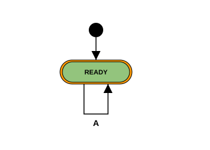
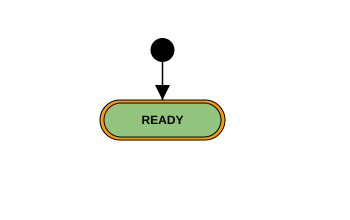

This document is published by Open Vision Technology LLC.

8 Thompson Pond Road, Stoneham, MA 02180, U.S.A.

Tel: 339-293-2151

Copyright 2025 by Open Vision Technology LLC.

This document contains proprietary information protected by copyright. All rights reserved. No part of this document may be photocopied or reproduced without the prior written consent of Open Vision Technology LLC.

##

# **Service Summary**

Here is the list of the core clients services:

| Service | Purpose | 
| :---- | :---- |
| [Dash Board](#dash-board) | Discover subsystems and provide information of the subsystems in the network. |
| [Discovery Client](#discovery-client) | Obtain services, resources, and agents of the subsystem. |
| [Agent Discovery Client](#agent-discovery-client) | Obtain agents and agent status of the subsystem. |
| [Data Topics Discovery Client](#data-topics-discovery-client) | Obtain available data topics of the subsystem. |
| [Transform Reporter Discovery Client](#transform-reporter-discovery-client) | Obtain transform reporter information of the subsystem. |
| [Subsystem Access Client](#subsystem-access-client) | Obtain subsystem access. |
| [Subsystem Control Client](#subsystem-control-client) | Obtain subsystem control. |
| [Safety Client](#safety-client) | Send e-stop button state to the Safety service. |
| [Comp Control Client](#comp-control-client) | Obtain access control of a component. |
| [Management Client](#management-client) | Keep management state in READY. |
| [Subsystem State Client](#subsystem-state-client) | Manage subsystem state of a subsystem. |
| [Operating Mode Client](#operating-mode-client) | Send Set Operating Mode to the components that host Operating Mode service. |
| [Agent Client](#agent-client) | Run and monitor the progress of the Agent. |
| [Db Data Store](#db-data-store) | Implement GetData() to provide data from the CoreClientDbDataStore. |
| [Data Store](#data-store) | Implement GetData() to provide data from the CoreClientDataStore. |
| [Data Store Client](#data-store-client) | Query Data Store for data of the selected subsystem. |
| [Data Topic Client](#data-topic-client) | Update data topic subscriptions. |
| [Transform Reporter Client](#transform-reporter-client) | Obtain transform from Transform Reporter service. |

##

# **Dashboard** [⬆️](#service-summary "Service Summary")

The Dashboard is to provide information of the subsystems, services, resources, agents, and component status on the network.

The Dashboard globally broadcast the Query Identification to look for the Discovery services of the subsystems on the network. It then queries the service lists, component status details, resources, and agents from the subsystems.

The Dashboard updates the core\_clients\_db\_data\_store with the collected information.

Require: none  
Inherit from: none

## **Service Behavior**

### **State Diagram**

### **State Actions**

| State     | Actions                                                                                                     |
| :-------- | :---------------------------------------------------------------------------------------------------------- |
| READY (*) | Globally broadcast Query Identification to look for the Discovery services of the subsystems on the network |

### **Internal Events**

| Event            | Parameters | Purpose                        |
| :--------------- | :--------- | :----------------------------- |
| ieReceiveMessage |            | Indicate a message is received |

#### **Transitions**

| Transition | Trigger | Condition | Action |
| :---- | :---- | :---- | :---- |
| A | ieReceiveMessage |  | Process received message |

## **Protocol**

### **Incoming Message Set**

| \#   | ID                        | Message                         |
| :--- | :------------------------ | :------------------------------ |
| 1    | H:0x00000001 L:0x00000111 | Report Identification           |
| 2    | H:0x00000001 L:0x00000113 | Report Subsystem Services       |
| 3    | H:0x00000001 L:0x00000120 | Report Subsystem Health         |
| 4    | H:0x00000001 L:0x00000121 | Report Subsystem Status Details |
| 5    | H:0x00000001 L:0x00000122 | Report Subsystem Health Context |
| 6    | H:0x00000001 L:0x00000149 | Report Subsystem Resources      |
| 7    | H:0x00000001 L:0x0000015C | Report Agents                   |
| 8    | H:0x00000001 L:0x00000127 | Report Subsystem Control Status |

### **Outgoing Message Set**

| \#   | ID                        | Message                         |
| :--- | :------------------------ | :------------------------------ |
| 1    | H:0x00000001 L:0x0000010D | Query Identification            |
| 2    | H:0x00000001 L:0x00000110 | Query Subsystem Services        |
| 3    | H:0x00000001 L:0x0000011C | Query Subsystem Health          |
| 4    | H:0x00000001 L:0x0000011D | Query Subsystem Status Details  |
| 5    | H:0x00000001 L:0x0000011E | Query Subsystem Health Context  |
| 6    | H:0x00000001 L:0x00000148 | Query Subsystem Resources       |
| 7    | H:0x00000001 L:0x0000015B | Query Agents                    |
| 8    | H:0x00000001 L:0x00000126 | Query Subsystem Control Status  |

### **Parameters**

1) CYCLEINTERVAL	double, time interval in seconds of each cycle, default=0.1.  
     
2) QUERYIDENTIFICATIONINTERVAL	double, time interval in seconds to globally broadcast Query Identification messages to discover subsystems, default=10.0.

3) IDENTIFICATIONCHECKINTERVAL	double, time interval in seconds to check whether discovered subsystem identifications in CoreClientsDBDataStore have expired, default=10.0.

4) DATACHECKINTERVAL	double, time interval in seconds to check whether subsystem services, resources, and agents in CoreClientsDBDataStore have expired, default=5.0.  
     
5) QUERYSTATUSINTERVAL	double, time interval in seconds to send Query Subsystem Control Status, Query Subsystem Health, and Query Subsystem Status Details messages, default=1.0.  
     
6) QUERYCONTEXTINTERVAL	double, time interval in seconds to send Query Subsystem Health Context messages to StatusMonitor services, default=3.0.  
     
7) STATUSTIMEOUT	double, timeout in seconds for not receiving subsystem control status, health, and status details updates, default=5.0.  
     
8) CONTEXTTIMEOUT	double, timeout in seconds for not receiving subsystem health context updates, default=10.0.  
     
9) STATUSCHECKINTERVAL	double, time interval in seconds to check whether subsystem control status, health, or status details in CoreClientsDBDataStore have expired, default=5.0.  
     
10) CONTEXTCHECKINTERVAL	double, time interval in seconds to check whether subsystem health contexts in CoreClientsDBDataStore have expired, default=10.0.  
     
11) CERTIFICATE	string, certificate sent in Query Identification messages to discover subsystems, default="unclassified".

##

# **Discovery Client** [⬆️](#service-summary "Service Summary")

When a subsystem is selected for control and command operations, the Discovery Client service obtains information of the services and resources of the subsystem.

The Discovery Client updates the CoreClientDataStore that the information of services and resources can be obtained through the GetData Interface of the Data service.

Require: none  
Inherit from: none

## **Service Behavior**

### **State Diagram**

### **State Actions**

| State | Actions                                                                                                                      |
| :---- | :--------------------------------------------------------------------------------------------------------------------------- |
| READY | Periodically query comp services list from the selected subsystem. Periodically query resources from the selected subsystem. |

### **Internal Events**

| Event            | Parameters | Purpose               |
| :--------------- | :--------- | :-------------------- |
| ieReceiveMessage |            | A message is received |

### **Transitions**

| Transition | Trigger | Condition | Action |
| :---- | :---- | :---- | :---- |
| A | ieReceiveMessage |  | Process received message |

## **Protocol**

### **Incoming Message Set**

| \#   | ID                        | Message                    |
| :--- | :------------------------ | :------------------------- |
| 1    | H:0x00000001 L:0x00000111 | Report Identification      |
| 2    | H:0x00000001 L:0x00000113 | Report Subsystem Services  |
| 3    | H:0x00000001 L:0x00000149 | Report Subsystem Resources |

### **Outgoing Message Set**

| \#   | ID                        | Message                   |
| :--- | :------------------------ | :------------------------ |
| 1    | H:0x00000001 L:0x0000010D | Query Identification      |
| 2    | H:0x00000001 L:0x00000110 | Query Subsystem Services  |
| 3    | H:0x00000001 L:0x00000148 | Query Subsystem Resources |

## **Parameters**

1) CYCLEINTERVAL	double, time interval in seconds of each cycle, default=0.1.  
     
2) QUERYIDENTIFICATIONINTERVAL	double, time interval in seconds to send Query Identification messages to the selected subsystem's Discovery service, default=2.0.  
     
3) QUERYSERVICESINTERVAL	double, time interval in seconds to send Query Subsystem Services messages to the selected subsystem's Discovery service, default=2.0.

4) QUERYRESOURCESINTERVAL	double, time interval in seconds to send Query Subsystem Resources messages to the selected subsystem's Resource Discovery service, default=2.0.  
   

## **Override Functions**

1) virtual uli\_sdk::utils::message\_utils::CompAddress GetSubsystemManager() const;  
     
   Subclass overrides this function to provide the component address of the selected Subsystem Manager to query for identification, services, and resources (default returns an invalid CompAddress()).

##

# **Agent Discovery Client** [⬆️](#service-summary "Service Summary")

When a subsystem is selected for control and command operations, the Agent Discovery Client service obtains information of agents and agent status of the subsystem.

The Agent Discovery Client updates the CoreClientDataStore with the information of agents and agent status found. Data service implements GetData() to provide the agents and agent status information. Refer to the Data service.

Require: none  
Inherit from: none

## **Service Behavior**

### **State Diagram**

### **State Actions**

| State     | Actions                                                                                                      |
| :-------- | :----------------------------------------------------------------------------------------------------------- |
| READY (*) | Periodically query agents from the Agent Discovery service. Periodically query agent status from the agents. |

### **Internal Events**

| Event            | Parameters | Purpose               |
| :--------------- | :--------- | :-------------------- |
| ieReceiveMessage |            | A message is received |

### **Transitions**

| Transition | Trigger | Condition | Action |
| :---- | :---- | :---- | :---- |
| A | ieReceiveMessage |  | Process received message |

## **Protocol**

### **Incoming Message Set**

| \#   | ID                        | Message             |
| :--- | :------------------------ | :------------------ |
| 1    | H:0x00000001 L:0x0000015C | Report Agents       |
| 2    | H:0x00000001 L:0x00000157 | Report Agent Status |

### **Outgoing Message Set**

| \#   | ID                        | Message            |
| :--- | :------------------------ | :----------------- |
| 1    | H:0x00000001 L:0x0000015B | Query Agents       |
| 2    | H:0x00000001 L:0x00000156 | Query Agent Status |

## **Parameters**

1) CYCLEINTERVAL	double, time interval in seconds of each cycle, default=0.1.  
     
2) QUERYAGENTSINTERVAL	double, time interval in seconds to send Query Agents messages to the AgentDiscovery service, default=5.0.

3) QUERYAGENTSTATUSINTERVAL	double, time interval in seconds to send Query Agent Status messages to discovered agents, default=1.0.

##

# **Data Topic Discovery Client** [⬆️](#service-summary "Service Summary")

The Data Topic Discovery Client looks for the Data Topic Discovery service and then queries the available data topics. It updates the core client data store with the information of the reported available data topics.

Require: none  
Inherit from: none

## **Service Behavior**

### **State Diagram**

### **State Actions**

| State | Actions                                                                                      |
| :---- | :------------------------------------------------------------------------------------------- |
| READY | Periodically sends Query Available Data Topics messages to the Data Topic Discovery service. |

### **Internal Events**

| Event            | Parameters | Purpose               |
| :--------------- | :--------- | :-------------------- |
| ieReceiveMessage |            | A message is received |

### **Transitions**

| Transition | Trigger | Condition | Action |
| :---- | :---- | :---- | :---- |
| A | ieReceiveMessage |  | Process received message |

## **Protocol**

### **Incoming Message Set**

| \#   | ID                        | Message                      |
| :--- | :------------------------ | :--------------------------- |
| 1    | H:0x00000001 L:0x0000014F | Report Available Data Topics |
| 2    | H:0x00000001 L:0x00000151 | Report Schemas               |

### **Outgoing Message Set**

| \#   | ID                        | Message                     |
| :--- | :------------------------ | :-------------------------- |
| 1    | H:0x00000001 L:0x0000014E | Query Available Data Topics |
| 2    | H:0x00000001 L:0x00000150 | Query Schemas               |

## **Parameters**

1) CYCLEINTERVAL	double, time interval in seconds of each cycle, default=0.1.  
     
2) QUERYINTERVAL	double, time interval in seconds to send Query Available Data Topics and Query Schemas messages to the DataTopicDiscovery service, default=5.0.

## **Override Functions**

1) virtual uli\_sdk::utils::message\_utils::CompAddress GetServiceAddress() const;  
     
   Obtain the component address of the DataTopicDiscovery service at the target subsystem to query available data topics and schemas (default looks up "core.DataTopicDiscovery" in CoreClientsDataStore).  
     
2) virtual uli\_sdk::utils::uuid\_utils::UliUuid GetSessionUuid() const;  
     
   Obtain the target subsystem access session UUID sent in Query Available Data Topics and Query Schemas messages (default retrieves the active session UUID from CoreClientsDataStore::GetSubsystemAccessClient()).

##

# **Transform Reporter Discovery Client** [⬆️](#service-summary "Service Summary")

Transform Reporter Discovery Client looks for the Transform Reporter Discovery service and then queries the available transform reporter services.

Transform Reporter Discovery Client updates the CoreClientDataStore with the information of the transform reporters found.

Require: none  
Inherit from: none

## **Service Behavior**

### **State Diagram**

### **State Actions**

| State | Actions                                                                               |
| :---- | :------------------------------------------------------------------------------------ |
| READY | Periodically query transform reporters from the Transform Reporter Discovery service. |

### **Internal Events**

| Event            | Parameters | Purpose               |
| :--------------- | :--------- | :-------------------- |
| ieReceiveMessage |            | A message is received |

### **Transitions**

| Transition | Trigger | Condition | Action |
| :---- | :---- | :---- | :---- |
| A | ieReceiveMessage |  | Process received message |

## **Protocol**

### **Incoming Message Set**

| \#   | ID                        | Message                    |
| :--- | :------------------------ | :------------------------- |
| 1    | H:0x00000001 L:0x00000163 | Report Transform Reporters |

### **Outgoing Message Set**

| \#   | ID                        | Message                   |
| :--- | :------------------------ | :------------------------ |
| 1    | H:0x00000001 L:0x00000162 | Query Transform Reporters |

## **Parameters**

1) CYCLEINTERVAL	double, time interval in seconds of each cycle, default=0.1.  
     
2) QUERYINTERVAL	double, time interval in seconds to send Query Transform Reporters messages to the TransformReporterDiscovery service, default=5.0.

##

# **Subsystem Access Client** [⬆️](#service-summary "Service Summary")

Subsystem Access Client Service periodically sends Request Subsystem Access to gain access to the subsystem.

It obtains a boolean indicating whether to  gain the subsystem access from the overridden function GainAccess().

Subsystem Access Client updates the Subsystem Access Client Rec of the CoreClientDataStore.

Require: none  
Inherit from: none

## **Service Behavior**

### **State Diagram**

### **State Actions**

| State | Actions                                     |
| :---- | :------------------------------------------ |
| READY | Periodically sends Request Subsystem Access |

### **Internal Events**

| Event            | Parameters | Purpose                        |
| :--------------- | :--------- | :----------------------------- |
| ieReceiveMessage |            | Indicate a message is received |

### **Transitions**

| Transition | Trigger | Condition | Action |
| :---- | :---- | :---- | :---- |
| A | ieReceiveMessage |  | Process received message |

## **Protocol**

### **Incoming Message Set**

| \#   | ID                        | Message                  |
| :--- | :------------------------ | :----------------------- |
| 1    | H:0x00000001 L:0x00000124 | Confirm Subsystem Access |

### **Outgoing Message Set**

| \#   | ID                        | Message                  |
| :--- | :------------------------ | :----------------------- |
| 1    | H:0x00000001 L:0x00000123 | Request Subsystem Access |

## **Parameters**

1) CYCLEINTERVAL	double, time interval in seconds of each cycle, default=0.1.

2) DESCRIPTOR	string, descriptor of the component application sent in Request Subsystem Access messages, default="SubsystemAccessClient".  
     
3) REQUESTINTERVAL	double, time interval in seconds to send Request Subsystem Access messages to the SubsystemAccess service, default=1.0.  
     
4) CERTIFICATE	string, certificate sent in Request Subsystem Access messages to gain subsystem access, default="unclassified".  
   

## **Override Functions**

1) virtual bool GainAccess() const;  
     
   Subclass overrides to indicate whether to request access to the subsystem (true to send Request Subsystem Access, false otherwise; default returns false).

##

# **Subsystem Control Client** [⬆️](#service-summary "Service Summary")

Subsystem Control Client Service periodically sends Request Subsystem Control to gain control of the subsystem.

It obtains control cmd from the overridden function GetControlCmd(). The control cmd indicates whether to obtain or release control of the subsystem.

Subsystem Control Client updates the Subsystem Control Client Rec of the CoreClientDataStore.

Require: none  
Inherit from: none

## **Service Behavior**

### **State Diagram**

### **State Actions**

| State | Actions                                      |
| :---- | :------------------------------------------- |
| READY | Periodically sends Request Subsystem Control |

### **Internal Events**

| Event            | Parameters | Purpose                        |
| :--------------- | :--------- | :----------------------------- |
| ieReceiveMessage |            | Indicate a message is received |

### **Transitions**

| Transition | Trigger | Condition | Action |
| :---- | :---- | :---- | :---- |
| A | ieReceiveMessage |  | Process received message |

## **Protocol**

### **Incoming Message Set**

| \#   | ID                        | Message                         |
| :--- | :------------------------ | :------------------------------ |
| 1    | H:0x00000001 L:0x0000012B | Confirm Subsystem Control       |
| 2    | H:0x00000001 L:0x0000012E | Reject Subsystem Control        |
| 3    | H:0x00000001 L:0x0000012D | Request Release                 |
| 4    | H:0x00000001 L:0x00000127 | Report Subsystem Control Status |

### **Outgoing Message Set**

| \#   | ID                        | Message                        |
| :--- | :------------------------ | :----------------------------- |
| 1    | H:0x00000001 L:0x00000128 | Request Subsystem Control      |
| 2    | H:0x00000001 L:0x00000129 | Release Subsystem Control      |
| 3    | H:0x00000001 L:0x0000012A | Request Handover               |
| 4    | H:0x00000001 L:0x00000126 | Query Subsystem Control Status |

## **Parameters**

1) CYCLEINTERVAL	double, time interval in seconds of each cycle, default=0.1.

2) DESCRIPTOR	string, descriptor of the component application sent when requesting subsystem control, default="SubsystemControlClient".  
     
3) REQUESTINTERVAL	double, time interval in seconds to send Request Subsystem Control, Release Subsystem Control, or Request Handover messages, default=0.2.  
     
4) QUERYSTATUSINTERVAL	double, time interval in seconds to send Query Subsystem Control Status messages to the SubsystemControl service, default=5.0.  
     
5) CERTIFICATE	string, certificate sent in Request Subsystem Control and Request Handover messages, default="uli".  
     
6) AUTHORITYCODE	uint8, authority code of this client sent in Request Subsystem Control and Request Handover messages, default=150.  
   

## **Override Functions**

1) virtual ::ControlCmdEnum GetControlCmd() const;  
     
   Subclass overrides to provide the Control Cmd directing the client to obtain or release control of the subsystem, an Enum of the following values (default returns ::ControlCmdEnum::UNKNOWN):  
     
   \[ UNKNOWN, OBTAIN, RELEASE, UNCHANGE\]

##

# **Safety Client** [⬆️](#service-summary "Service Summary")

The Safety Client service monitors the Estop button state and send Set Estop messages accordingly to the Safety service. For redundancy, the Safety Client queries Subsystem Health Summary from the Status Monitor service of the subsystem. It sets E-stop if the Subsystem Health Summary is in Error or Fatal.

Safety Client service obtains the estop button state from the overridden GetEStopButton() function.

Note that Safety Client needs to obtain control of the Safety service while sending the Set Estop message.

Require: none  
Inherit from: none

## **Service Behavior**

### **State Diagram**

### **State Actions**

| State       | Actions                                                                                                                                      |
| :---------- | :------------------------------------------------------------------------------------------------------------------------------------------- |
| WAITING     | Wait for having Subsystem Control.                                                                                                           |
| OPERATIONAL | Monitor the Estop button state and the health summary of the subsystem, sends Set Estop messages with the Estop state to the Safety service. |
| FAULT       | Hardware problem, stop sending Set Estop messages.                                                                                           |

### **Internal Events**

| Event            | Parameters | Purpose |
| :--------------- | :--------- | :------ |
| ieReceiveMessage |            |         |

### **Transitions**

| Transition | From     | To         | Trigger                 | Condition  | Action    |
| :--------- | :------- | :--------- | :---------------------- | :--------- | :-------- |
| A          | WAITING  | OPERATIONAL | Have subsystem control    |            |           |
| B          | OPERATIONAL | WAITING | Loss of subsystem control |            |           |
| C          | OPERATIONAL | FAULT   | Hardware problem detected |            |           |

## **Protocol**

### **Incoming Message Set**

| \#   | ID                        | Message                 |
| :--- | :------------------------ | :---------------------- |
| 1    | H:0x00000001 L:0x00000120 | Report Subsystem Health |
| 2    | H:0x00000001 L:0x00000132 | Confirm Control         |
| 3    | H:0x00000001 L:0x00000133 | Reject Control          |
| 4    | H:0x00000001 L:0x00000134 | Report Control          |

### **Outgoing Message Set**

| \#   | ID                        | Message                |
| :--- | :------------------------ | :--------------------- |
| 1    | H:0x00000001 L:0x0000011C | Query Subsystem Health |
| 2    | H:0x00000001 L:0x00000143 | Set Estop              |
| 3    | H:0x00000001 L:0x0000012F | Request Control        |
| 4    | H:0x00000001 L:0x00000130 | Release Control        |
| 5    | H:0x00000001 L:0x00000131 | Query Control          |

## **Parameters**

1) CYCLEINTERVAL	double, time interval in seconds of each cycle, default=0.02.

2) CRITICALMESSAGEINTERVAL	double, time interval in seconds to send Set Estop messages to the Safety service, default=0.02.  
     
3) MESSAGEINTERVAL	double, time interval in seconds to send Request Control or Query Control messages to the Safety component, default=0.1.  
     
4) AUTHORITYCODE	uint8, authority code used to gain control of the Safety component, default=210.  
     
5) CHECKSUBSYSTEMCONTROL	double, time interval in seconds to check whether this client has subsystem control, default=0.5.

## **Override Functions**

1) virtual ::EStopEnum GetEStopButton() const;  
     
   Subclass overrides to provide the e-stop button state sent in Set Estop messages to the Safety service, an Enum of the following values (default returns ::EStopEnum::UNCHANGE):  
     
   \[ UNKNOWN, CLEAR, SET, UNCHANGE\]

##

# **Comp Control Client** [⬆️](#service-summary "Service Summary")

Access Control Client Service periodically sends Request Control to gain control of the comp that hosts subsystem state service or resource or agent that perform certain functions. The type of service the comp hosts is specified by the COMPTYPE parameter.

The upstream controller provides the control cmd to direct the Access Control Client, either obtaining or releasing the control.

Require: none  
Inherit from: none

## **Service Behavior**

### **State Diagram**

### **State Actions**

| State | Actions                            |
| :---- | :--------------------------------- |
| READY | Periodically sends Request Control |

### **Internal Events**

| Event            | Parameters | Purpose                        |
| :--------------- | :--------- | :----------------------------- |
| ieReceiveMessage |            | Indicate a message is received |

### **Transitions**

| Transition | Trigger | Condition | Action |
| :---- | :---- | :---- | :---- |
| A | ieReceiveMessage |  | Process received message |

## **Protocol**

### **Incoming Message Set**

| \#   | ID                        | Message         |
| :--- | :------------------------ | :-------------- |
| 1    | H:0x00000001 L:0x00000132 | Confirm Control |
| 2    | H:0x00000001 L:0x00000133 | Reject Control  |
| 3    | H:0x00000001 L:0x00000134 | Report Control  |

### **Outgoing Message Set**

| \#   | ID                        | Message         |
| :--- | :------------------------ | :-------------- |
| 1    | H:0x00000001 L:0x0000012F | Request Control |
| 2    | H:0x00000001 L:0x00000130 | Release Control |
| 3    | H:0x00000001 L:0x00000131 | Query Control   |

## **Parameters**

1) CYCLEINTERVAL	double, time interval in seconds of each cycle, default=0.1.

2) REQUESTINTERVAL	double, time interval in seconds to send Request Control or Release Control messages, default=0.2.  
     
3) QUERYINTERVAL	double, time interval in seconds to send Query Control messages, default=0.5.  
     
4) SERVERCOMPTYPE	string, type of target component service to control \["UNKNOWN" | "AGENT" | "RESOURCE" | "SUBSYSTEM\_STATE" | "OTHERS"\], used to resolve the target component address and update control status in CoreClientsDataStore, default="UNKNOWN".

5) AUTHORITYCODE	uint8, authority code sent in Request Control messages when requesting component control, default=150.  
   
## **Override Functions**

1) virtual std::string GetAgentUri() const;  
     
   Return the URI of the agent this client is to control (for example: "teleop.apps.uli\_sdk.ovt.com"), or "" if not controlling an agent. If SERVERCOMPTYPE is AGENT, the Comp Control Client uses the URI to find the component address and control command of the agent in CoreClientsDataStore.  
     
2) virtual ::ResourceTypeEnum GetResourceType() const;  
     
   Return the resource type of the resource this client is to control (or ::ResourceTypeEnum::UNKNOWN if not controlling a resource). ::ResourceTypeEnum has the values: \[UNKNOWN, VIDEO, AUDIO, WEB, MCP, TELEMETRY, EXCLUSIVE\].  
     
   If SERVERCOMPTYPE is RESOURCE, the Comp Control Client uses the resource type and resource name to find the component address and control command of the resource in CoreClientsDataStore.  
     
3) virtual std::string GetResourceName() const;  
     
   Return the name of the resource this client is to control (or "" if not controlling a resource). Used with GetResourceType() when SERVERCOMPTYPE is RESOURCE.  
     
4) virtual ::ControlCmdEnum GetControlCmd() const;  
     
   Return the control command (OBTAIN or RELEASE) directing the Comp Control Client whether to request or release control of the target component (default queries CoreClientsDataStore based on SERVERCOMPTYPE). ::ControlCmdEnum has the values: \[UNKNOWN, OBTAIN, RELEASE, UNCHANGE\].  
     
5) virtual uli\_sdk::utils::uuid\_utils::UliUuid GetSessionUuid() const;  
     
   Return the subsystem control session UUID sent in Request Control and Release Control messages (default retrieves the active session UUID from CoreClientsDataStore::GetSubsystemControlClient()).

##

# **Management Client** [⬆️](#service-summary "Service Summary")

Management Client Service periodically sends GO to have the Management service transitioning to Ready state. It works along with the Access Control Client since it needs to have control of the comp before sending the GO command.

The Management Client also uses the comp type and agent url or resource type/name to find the address of comp for sending GO command to. It sends the GO command once having the access control of the comp.

Require: none  
Inherit from: none

## **Service Behavior**

### **State Diagram**

### **State Actions**

| State | Actions                                         |
| :---- | :---------------------------------------------- |
| READY | Periodically sends GO if it has access control. |

### **Internal Events**

| Event            | Parameters | Purpose                        |
| :--------------- | :--------- | :----------------------------- |
| ieReceiveMessage |            | Indicate a message is received |

### **Transitions**

| Transition | Trigger | Condition | Action |
| :---- | :---- | :---- | :---- |
| A | ieReceiveMessage |  | Process received message |

## **Protocol**

### **Incoming Message Set**

| \#   | ID                        | Message                 |
| :--- | :------------------------ | :---------------------- |
| 1    | H:0x00000001 L:0x0000013F | Report Management State |

### **Outgoing Message Set**

| \#   | ID                        | Message                |
| :--- | :------------------------ | :--------------------- |
| 1    | H:0x00000001 L:0x00000137 | Go                     |
| 2    | H:0x00000001 L:0x0000013E | Query Management State |

## **Parameters**

1) CYCLEINTERVAL	double, time interval in seconds of each cycle, default=0.1.

2) GOINTERVAL	double, time interval in seconds to send Go messages to keep the target component's Management service in the READY state, default=0.2.  
     
3) QUERYINTERVAL	double, time interval in seconds to send Query Management State messages to the target component, default=0.5.  
     
4) SERVERCOMPTYPE	string, type of target component service \["UNKNOWN" | "AGENT" | "RESOURCE" | "SUBSYSTEM\_STATE" | "OTHERS"\], used to resolve the target component address and update management state in CoreClientsDataStore, default="UNKNOWN".

## **Override Functions**

1) virtual std::string GetAgentUri() const;  
     
   Return the URI of the agent whose Management service this client controls (for example: "teleop.apps.uli\_sdk.ovt.com"), or "" if not controlling an agent. If SERVERCOMPTYPE is AGENT, the Management Client uses the URI to find the component address of the agent in CoreClientsDataStore.  
     
2) virtual ::ResourceTypeEnum GetResourceType() const;  
     
   Return the resource type of the resource whose Management service this client controls (or ::ResourceTypeEnum::UNKNOWN if not controlling a resource). ::ResourceTypeEnum has the values: \[UNKNOWN, VIDEO, AUDIO, WEB, MCP, TELEMETRY, EXCLUSIVE\].  
     
   If SERVERCOMPTYPE is RESOURCE, the Management Client uses the resource type and resource name to find the component address of the resource in CoreClientsDataStore.  
     
3) virtual std::string GetResourceName() const;  
     
   Return the name of the resource whose Management service this client controls (or "" if not controlling a resource). Used with GetResourceType() when SERVERCOMPTYPE is RESOURCE.  
     
4) virtual bool OkToSendGo() const;  
     
   Return true if it is ready to send Go messages to the target component's Management service (when SERVERCOMPTYPE is AGENT, default checks that the agent client running state in CoreClientsDataStore is CONTROL).  
     
5) virtual uli\_sdk::utils::uuid\_utils::UliUuid GetSessionUuid() const;  
     
   Return the subsystem control session UUID sent in Go messages (default retrieves the active session UUID from CoreClientsDataStore::GetSubsystemControlClient()).

## 

# **Subsystem State Client** [⬆️](#service-summary "Service Summary")

Subsystem State Client Service manages the subsystem states of the subsystem. It sets the subsystem state according to its current state. Refer to “State Actions” below. 

Subsystem State Client service obtains cmd from the overridden GetSubsystemStateCmd() function. It transitions to state according to the cmd. Refer to “Transitions” below.

Subsystem State Client service updates the Subsystem State Client Rec of the CoreClientsDataStore.

Note that the comp hosting Subsystem State Client needs to host Access Control Client to obtain the exclusive control of the Subsystem State Service.

Require: none  
Inherit from: none

## **Service Behavior**

### **State Diagram**

### **State Actions**

| State          | Actions                                                |
| :------------- | :----------------------------------------------------- |
| WAITING        | Waiting to have control of the Subsystem State Service |
| READY          | Sends Set Subsystem State (OPERATIONAL)                |
| RESET          | Sends Set Subsystem State (RESET)                      |
| SHUTDOWN       | Sends Set Subsystem State (SHUTDOWN)                   |
| RENDER USELESS | Sends Set Subsystem State (RENDER USELESS)             |

### **Internal Events**

| Event            | Parameters | Purpose                        |
| :--------------- | :--------- | :----------------------------- |
| ieReceiveMessage |            | Indicate a message is received |

### **Transitions**

| Transition | Trigger                                        | Condition  | Action |
| :--------- | :--------------------------------------------- | :--------- | :----- |
| A          | Have control of the Subsystem State Service    |            |        |
| B          | Loss of control of the Subsystem State Service |            |        |
| C          | Commanded to RESET                             |            |        |
| D          | Subsystem State is INITIALIZING                | INITIALIZE |        |  |
| E          | Commanded to SHUTDOWN                          |            |        |
| F          | Commanded to RENDER USELESS                    |            |        |
| G          | Loss of control of the Subsystem State Service |            |        |
| H          | Loss of control of the Subsystem State Service |            |        |

## **Protocol**

### **Incoming Message Set**

| \#   | ID                        | Message                |
| :--- | :------------------------ | :--------------------- |
| 1    | H:0x00000001 L:0x00000142 | Report Subsystem State |

### **Outgoing Message Set**

| \#   | ID                        | Message               |
| :--- | :------------------------ | :-------------------- |
| 1    | H:0x00000001 L:0x00000141 | Query Subsystem State |
| 2    | H:0x00000001 L:0x00000140 | Set Subsystem State   |

## **Parameters**

1) CYCLEINTERVAL	double, time interval in seconds of each cycle, default=0.1.  
     
2) SETINTERVAL	double, time interval in seconds to send Set Subsystem State messages (OPERATIONAL, RESET, SHUTDOWN, RENDER\_USELESS) to the SubsystemState service, default=0.5.

3) QUERYINTERVAL	double, time interval in seconds to send Query Subsystem State messages to the SubsystemState service, default=2.0.  
   

## **Override Functions**

1) virtual ::SubsystemStateCmdEnum GetSubsystemStateCmd() const;  
     
   Subclass overrides to provide the Subsystem State Cmd directing subsystem state transitions and Set Subsystem State messages, an Enum of the following values (default returns ::SubsystemStateCmdEnum::UNKNOWN):  
     
   \[ UNKNOWN, RESET, SHUTDOWN, RENDER\_USELESS, OPERATIONAL, UNCHANGE\]

##

# **Operating Mode Client** [⬆️](#service-summary "Service Summary")

Operating Mode Client service periodically sends Set Operating Mode messages to the components that host Operating Mode service.

Require: none  
Inherit from: none

## **Service Behavior**

### **State Diagram**

### **State Actions**

| State | Actions                               |
| :---- | :------------------------------------ |
| READY | Periodically sends Set Operating Mode |

### **Internal Events**

| Event            | Parameters | Purpose                        |
| :--------------- | :--------- | :----------------------------- |
| ieReceiveMessage |            | Indicate a message is received |

### **Transitions**

| Transition | Trigger | Condition | Action |
| :--------- | :------ | :-------- | :----- |
|            |         |           |        |

## **Protocol**

### **Incoming Message Set**

| \#   | ID                        | Message               |
| :--- | :------------------------ | :-------------------- |
| 1    | H:0x00000001 L:0x00000146 | Report Operating Mode |

### **Outgoing Message Set**

| \#   | ID                        | Message              |
| :--- | :------------------------ | :------------------- |
| 1    | H:0x00000001 L:0x00000144 | Set Operating Mode   |
| 2    | H:0x00000001 L:0x00000145 | Query Operating Mode |

## **Parameters**

1) CYCLEINTERVAL	double, time interval in seconds of each cycle, default=0.1.

2) SETINTERVAL	double, time interval in seconds to send Set Operating Mode messages to the SubsystemOperatingMode service, default=1.0.  
     
3) QUERYINTERVAL	double, time interval in seconds to send Query Operating Mode messages to the SubsystemOperatingMode service, default=2.0.  
   

## **Override Functions**

1) virtual ::OperatingCategoryEnum GetOperatingCategory() const;  
     
   Subclass overrides to provide the operating category sent in Set Operating Mode messages, an Enum of the following values (default returns ::OperatingCategoryEnum::UNKNOWN):  
     
   \[ UNKNOWN, STANDARD, ADMINISTRATIVE\]  
     
2) virtual ::OperatingModeEnum GetOperatingMode() const;  
     
   Subclass overrides to provide the operating mode sent in Set Operating Mode messages, an Enum of the following values (default returns ::OperatingModeEnum::UNKNOWN):  
     
   \[ UNKNOWN, STANDARD\_OPERATING, REDUCED, RIGOROUS, SILENT, HIBERNATED, TRAINING, MAINTENANCE\]

##

# **Agent Client** [⬆️](#service-summary "Service Summary")

Access Client Service is to command the Agent service going through Request, Control, and Complete stages.

The upstream controller provides the run command to direct the Agent Client to run Agent service or sit idle.

Require: none  
Inherit from: none

## **Service Behavior**

### **State Diagram** 

### **State Actions**

| State | Actions                               |
| :---- | :------------------------------------ |
| READY | Run the Agent service. Send Request if the running state is at request. Send Control if the running state is at control. Check if the running state timeout. Agent client keeps track of the progress of the interaction with the agent through the running state. The running state is the enum of “UNKNOWN”, “REQUEST”, “CONTROL”, “COMPLETE”. |

### **Internal Events**

| Event            | Parameters | Purpose                        |
| :--------------- | :--------- | :----------------------------- |
| ieReceiveMessage |            | Indicate a message is received |

### **Transitions**

| Transition | Trigger | Condition | Action |
| :---- | :---- | :---- | :---- |
| A | ieReceiveMessage |  | Process received message |

## **Protocol**

### **Incoming Message Set**

| \#   | ID                        | Message                   |
| :--- | :------------------------ | :------------------------ |
| 1    | H:0x00000001 L:0x00000153 | Report Agent Capabilities |
| 2    | H:0x00000001 L:0x00000155 | Confirm Agent             |
| 3    | H:0x00000001 L:0x00000157 | Report Agent Status       |
| 4    | H:0x00000001 L:0x00000159 | Report Agent Complete     |

### **Outgoing Message Set**

| \#   | ID                        | Message                  |
| :--- | :------------------------ | :----------------------- |
| 1    | H:0x00000001 L:0x00000152 | Query Agent Capabilities |
| 2    | H:0x00000001 L:0x00000154 | Request Agent            |
| 3    | H:0x00000001 L:0x00000156 | Query Agent Status       |
| 4    | H:0x00000001 L:0x00000158 | Set Agent Control        |

## **Parameters**

1) CYCLEINTERVAL	double, time interval in seconds of each cycle, default=0.1.

2) REQUESTINTERVAL	double, time interval in seconds to send Request Agent messages when in the REQUEST running state, default=0.2.  
     
3) CONTROLINTERVAL	double, time interval in seconds to send Set Agent Control messages when in the CONTROL running state, default=0.2.

4) CHECKTIMEOUTINTERVAL	double, time interval in seconds to check whether the running agent has timed out, default=0.2.  
     
5) QUERYINTERVAL	double, time interval in seconds to send Query Agent Capabilities and Query Agent Status messages to the target agent, default=2.0.  
   
## **Override Functions** 

1) virtual std::string GetAgentUri() const;  
     
   Return the URI of the agent this client controls (for example: "teleop.apps.uli\_sdk.ovt.com"), used to find the component address of the agent in CoreClientsDataStore (default returns "").  
     
2) virtual ::AgentRunningCmdEnum GetAgentRunningCmd() const;  
     
   Return the running command directing the Agent Client whether to run the agent (RUN) or remain idle (IDLE) (default returns ::AgentRunningCmdEnum::UNKNOWN). ::AgentRunningCmdEnum has values: \[UNKNOWN, IDLE, RUN\].

3) virtual void GetAgentRequestSpec(uli\_sdk::utils::message\_utils::DataJsonRecList\_t& configuration, uli\_sdk::utils::base\_utils::Float64\_t& completion\_timeout) const;  
     
   Provide the configuration records (DataJsonRecList\_t) and completion\_timeout (in seconds) sent when requesting the agent in Request Agent messages. The configuration list specifies JSON configuration records to configure the agent, and completion\_timeout specifies the maximum time in seconds the agent is allowed to run before timing out (0.0 specifies no time limit).  
     
4) virtual ::AgentControlCmdEnum GetAgentControlCmd() const;  
     
   Return the agent control command sent in Set Agent Control messages to direct the running Agent service to continue/resume running (RESUME), pause running (PAUSE), or cancel (CANCEL) (default returns ::AgentControlCmdEnum::UNKNOWN).  
     
   ::AgentControlCmdEnum has the values: \[UNKNOWN, RESUME, PAUSE, CANCEL\].  
     
5) virtual uli\_sdk::utils::message\_utils::DataJsonRecList\_t GetAgentControlParams() const;

   Return the list of control parameter records (DataJsonRecList\_t) specifying runtime parameters for the agent. Sent periodically along with the control command and user parameters in Set Agent Control messages while the agent is in the CONTROL running state.

6) virtual uli\_sdk::utils::message\_utils::DataJsonRecList\_t GetAgentUserParams() const;

   Return the list of user parameter records (DataJsonRecList\_t) specifying runtime user inputs for the agent (for example, joystick inputs). Sent periodically along with the control command and control parameters in Set Agent Control messages while the agent is in the CONTROL running state.

##

# **Db Data Store** [⬆️](#service-summary "Service Summary")

Db Data Store is a service to implement GetData() and SetData() functions for accessing the CoreClientDbDataStore.

Require: none  
Inherit from: none

## **Service Behavior**

### **State Diagram**

### **State Actions**

| State | Actions      |
| :---- | :----------- |
| READY | Does nothing |

### **Internal Events**

| Event            | Parameters | Purpose                        |
| :--------------- | :--------- | :----------------------------- |
| ieReceiveMessage |            | Indicate a message is received |

### **Transitions**

| Transition | Trigger | Condition | Action |
| :---- | :---- | :---- | :---- |
| A | ieReceiveMessage |  | Process received message |

## **Protocol**

### **Incoming Message Set**

| \#   | ID   | Message |
| :--- | :--- | :------ |
|      |      |         |

### **Outgoing Message Set**

| \#   | ID   | Message |
| :--- | :--- | :------ |
|     |      |         |

## **Parameters**

1) CYCLEINTERVAL	double, time interval in seconds of each cycle, default=0.1.

## **Get Data** {#get-data-2}

2) Get Subsystem Control Abstractions  
     
   scheme=data  
   location=subsystemcontrolabstractions\&id=0 //from all subsystems  
   location=subsystemcontrolabstractions\&id=\<subsystem\_id\>  //from the subsystem with the id  
     
   type= uli\_sdk::services::core\_clients::messages::SubsystemControlAbstractionRecList\_t  
     
   example: get the subsystem control abstraction from subsystem id 101  
     
   url:   
     
   “data://ocu.apps.uli\_sdk/core\_clients.DbDataStore?location=subsystemcontrolabstractions\&id=101

3) Get comp services listing from subsystems  
     
   scheme=data  
   location=subsystemservices\&id=0  //from all subsystems  
   location=subsystemservices\&id=\<subsystem\_id\>  //from the subsystem with the id  
     
   type=uli\_sdk::services::core\_clients::messages::SubsystemCompServicesRecList\_t  
     
   example: get comp services from all subsystems  
     
   url:  
     
   “data://any/core\_clients:DbDataStore?location=subsystemservices\&id=0  
     
4) Get status details listing from subsystems  
     
   scheme=data  
   location=subsystemstatusdetails\&id=0  //from all subsystems  
   location=subsystemstatusdetails\&id=\<subsystem\_id\>  //from the subsystem with the id  
     
   type=uli\_sdk::services::core\_clients::messages::SubsystemCompStatusDetailsRecList\_t  
     
   example: get the list of status details of the subsystem 101  
     
   url:  
     
   “data://any/core\_clients.DbDataStore?location=subsystemstatusdetails\&id=101  
     
5) Get resource listing from subsystems  
     
   scheme=data  
   location=subsystemresources\&id=0  //from all subsystems  
   location=subsystemresources\&id=\<subsyste\_id\>  //from the subsystem with the id  
     
   type=uli\_sdk::services::core\_clients::messagesSubsystemCompResourcesRecList\_t  
     
   example: get the resources listing of all the subsystems  
     
   url:  
     
   “data://any/core\_clients.DbDataStore?location=subsystemresources\&id=0”  
     
6) Get agent listing from subsystems  
     
   scheme=data  
   location=subsystemagents\&id=0  //from all subsystems  
   location=subsystemagents\&id=\<subsystem\_id\>  
     
   type=uli\_sdk::services::core\_clietns::messages::SubsystemAgentsRecList\_t  
     
   example: get the agent listing from all the subsystems  
     
   url:  
     
   “data://any/core\_clients..DbDataStore?location=subsystemagents\&id=0”

##

# **Data Store** [⬆️](#service-summary "Service Summary")

Data Store is a service to implement GetData() and SetData() functions for accessing the CoreClientDataStore. It also allows clients to query information regarding the Subsystem of client’s interest.

Overridden subclass extends the GetData() and SetData() for accessing to other Data Store.

Require: none  
Inherit from: none

## **Service Behavior**

### **State Diagram**

### **State Actions**

| State | Actions      |
| :---- | :----------- |
| READY | Does nothing |

### **Internal Events**

| Event            | Parameters | Purpose                        |
| :--------------- | :--------- | :----------------------------- |
| ieReceiveMessage |            | Indicate a message is received |

### **Transitions**

| Transition | Trigger | Condition | Action |
| :---- | :---- | :---- | :---- |
| A | ieReceiveMessage |  | Process received message |

## **Protocol**

### **Incoming Message Set**

| \#   | ID                        | Message                   |
| :--- | :------------------------ | :------------------------ |
| 1    | H:0x00000001 L:0x00000601 | Query Access Client       |
| 2    | H:0x00000001 L:0x00000603 | Query Control Client      |
| 3    | H:0x00000001 L:0x00000605 | Query State Client        |
| 4    | H:0x00000001 L:0x00000110 | Query Subsystem Services  |
| 5    | H:0x00000001 L:0x00000148 | Query Subsystem Resources |
| 6    | H:0x00000001 L:0x00000607 | Set Data Topic Clients    |

### **Outgoing Message Set**

| \#   | ID                        | Message                    |
| :--- | :------------------------ | :------------------------- |
| 1    | H:0x00000001 L:0x00000602 | Report Access Client       |
| 2    | H:0x00000001 L:0x00000604 | Report Control Client      |
| 3    | H:0x00000001 L:0x00000606 | Report State Client        |
| 4    | H:0x00000001 L:0x00000113 | Report Subsystem Services  |
| 5    | H:0x00000001 L:0x00000149 | Report Subsystem Resources |

## **Parameters**

1) CYCLEINTERVAL	double, time interval in seconds of each cycle, default=0.1.

## **Get Data**   

1) Get access client information  
     
   scheme=data  
   location=accessclient  
   type=uli\_sdk::services::core\_clients:: SubsystemAccessClientRec\_t  
     
   example: get the access client information  
     
   url:  
     
   “data://ocu.apps.uli\_sdk/core\_clients.DataStore?location=accessclient”  
     
2. Get control client information  
     
   scheme=data  
   location=controlclient  
   type=uli\_sdk::services::core\_clients::SubsystemControlClientRec\_t  
     
   example: get the control client information  
     
   url:  
     
   “data://ocu.apps.uli\_sdk/core\_clients.DataStore?location=controlclient”  
     
3. Get subsystem state client information  
     
   scheme=data  
   location=stateclient  
   type=uli\_sdk::services::core\_clients::SubsystemStateClientRec\_t  
     
   example: get the subsystem state client information  
     
   url:  
     
   “data://ocu.apps.uli\_sdk/core\_clients.DataStore?location=stateclient”  
     
4. Get the status details of the subsystem  
     
   scheme=data  
   location=statusdetails  
   type=uli\_sdk::utils::message\_utils::CompStatusDetailsRecList\_t  
     
   example: get the status details of the subsystem  
     
   url:  
     
   “data://ocu.apps.uli\_sdk/core\_clients.DataStore?location=statusdetails”  
     
5. Get the list of the resources of the type  
     
   scheme=data  
   location= resourcelist\&type=\[ssh, web, video, ws, proxy, driver, manipulator, ai\_tool, meta\]  
   type=uli\_sdk::utils::message\_utils::ResourceRecList\_t  
     
   example: get the list of resources of driver type  
     
   url:  
     
   “data://ocu.apps.uli\_sdk/core\_clients.DataStore?location=resourcelist\&type=driver”  
     
6. Get the resource details including resource list, their access client and status, and their management client state.  
     
   scheme=data  
   location= resourcedetails  
   type= collections of:  
     
   uli\_sdk::utils::message\_utils::ResourceRecList\_t

		uli\_sdk::services::core\_clients::messages::ResourceAccessClientRecList\_t  
	uli\_sdk::services::core\_clients::messages::ResourceAccessClientStatusRecList\_t  
	uli\_sdk::services::core\_clients::ResourceManagementClientStateRecList\_t

example: get the list of resources and their details

url:

“data://ocu.apps.uli\_sdk/core\_clients.DataStore?location=resourcedetails”

7. Get the agent list

	scheme=data  
location=agentlist  
type=uli\_sdk::services::core::messages::AgentRecList\_t  
example: Get the list of the agents

url:

“data://ocu.apps.uli\_sdk/core\_clients.DataStore?location=agentlist”

8. Get the status of the agents  
     
   scheme=data  
   location= agentstatuslist  
   type=uli\_sdk::services::core::messages::AgentStatusRecList\_t  
     
   example: get the status of the agents  
     
   url:  
     
   “data://ocu.apps.uli\_sdk/core\_clients.DataStore?location=agentstatuslist”  
     
9. Get the list of agents and status of their access clients and management clients  
     
   scheme=data  
   location= agentdetails  
   type=collections of:  
   		

   uli\_sdk::services::core::messages::AgentRecList\_t

   	uli\_sdk::services:core\_clients::messages::AgentAccessClientRecList\_t  
   	uli\_sdk::services::core\_clients::messages::AgentAccessClientStatusRecList\_t  
   	uli\_sdk::services::core\_clients::AgentManagementClientStatusRecList\_t  
     
   example: get the agent details of the subsystem  
     
   url:  
     
   “data://ocu.apps.uli\_sdk/core\_clients.DataStore?location=agentdetails”

10.  Get the list of data services of the subsystem  
      
    scheme=data  
    location=compdatatopiclist  
    type=uli\_sdk::utils::message\_utils::CompDataTopicRecList\_t  
      
    example: get the list of data services  
      
    url:  
      
    “data://ocu.apps.uli\_sdk/core\_clients.DataStore?location=compdatatopiclist”  
      
11. Get the list of the data topic clients, interacting with the data topic services  
    scheme=data  
    location=datatopicclientlist  
    type=uli\_sdk::services::core\_clients::messages:;DataTopicClientRecList\_t  
      
    example: Get the list of data topic clients of the subsystem  
      
    url:  
      
    “data://ocu.apps.uli\_sdk/core\_clients.DataStore?location=datatopicclientlist”  
      
12.  Get the list of transform reporter of the subsystem  
      
    scheme=data  
    location= transformreporterlist  
    type= uli\_sdk::services::core::messages::TransformReporterRecList\_t  
      
    example: Get the list of transform reporters  
      
    url:  
      
    “data://ocu.apps.uli\_sdk/core\_clients.DataStore?location=transformreporterlist”

##

# **Data Store Client** [⬆️](#service-summary "Service Summary")

Data Store Client is to query the information of the target subsystem, from the Data Store. It is intended to be used to share the information with different comp applications from the main comp app that performs the discovery client, subsystem state, access, and control clients.

Require: none  
Inherit from: none

## **Service Behavior**

### **State Diagram**

### **State Actions**

| State | Actions      |
| :---- | :----------- |
| READY | Does nothing |

### **Internal Events**

| Event            | Parameters | Purpose                        |
| :--------------- | :--------- | :----------------------------- |
| ieReceiveMessage |            | Indicate a message is received |

### **Transitions**

| Transition | Trigger | Condition | Action |
| :---- | :---- | :---- | :---- |
| A | ieReceiveMessage |  | Process received message |

## **Protocol**

### **Incoming Message Set**

| \#   | ID                        | Message                    |
| :--- | :------------------------ | :------------------------- |
| 1    | H:0x00000001 L:0x00000113 | Report Subsystem Services  |
| 2    | H:0x00000001 L:0x00000149 | Report Subsystem Resources |
| 3    | H:0x00000001 L:0x00000602 | Report Access Client       |
| 4    | H:0x00000001 L:0x00000604 | Report Control Client      |
| 5    | H:0x00000001 L:0x00000606 | Report State Client        |

### **Outgoing Message Set**

| \#   | ID                        | Message                   |
| :--- | :------------------------ | :------------------------ |
| 1    | H:0x00000001 L:0x00000110 | Query Subsystem Services  |
| 2    | H:0x00000001 L:0x00000148 | Query Subsystem Resources |
| 3    | H:0x00000001 L:0x00000601 | Query Access Client       |
| 4    | H:0x00000001 L:0x00000603 | Query Control Client      |
| 5    | H:0x00000001 L:0x00000605 | Query State Client        |
| 6    | H:0x00000001 L:0x00000607 | Set Data Topic Clients    |

## **Parameters**

1) CYCLEINTERVAL	double, time interval in seconds of each cycle, default=0.1.  
     
2) QUERYINTERVAL	double, time interval in seconds to send Query Subsystem Services to the Subsystem Manager for resolving the DataStore service address, default=2.0.  
     
3) QUERYDATASTOREINTERVAL	double, time interval in seconds to send Query Subsystem Services, Query Subsystem Resources, Query State Client, Query Access Client, and Query Control Client messages to the DataStore service, default=1.0.  
     
4) SETDATASTOREINTERVAL	double, time interval in seconds to send Set Data Topic Clients messages to the DataStore service, default=1.0.  
   
## 

# **Data Topic Client** [⬆️](#service-summary "Service Summary")

Subscription Client Service queries subscriptables and periodically sends Subscribe messages to update the subscrptions.

Require: none  
Inherit from: none

## **Service Behavior**

### **State Diagram**

### **State Actions**

| State | Actions                                                     |
| :---- | :---------------------------------------------------------- |
| READY | Periodically queries subscriptables and Subscribe messages. |

### **Internal Events**

| Event            | Parameters | Purpose                        |
| :--------------- | :--------- | :----------------------------- |
| ieReceiveMessage |            | Indicate a message is received |

### **Transitions**

| Transition | Trigger | Condition | Action |
| :--------- | :------ | :-------- | :----- |
|            |         |           |        |

## **Protocol**

### **Incoming Message Set**

| \#   | ID   | Message |
| :--- | :--- | :------ |

### **Outgoing Message Set**

| \#   | ID                        | Message               |
| :--- | :------------------------ | :-------------------- |
| 1    | H:0x00000001 L:0x0000014A | Subscribe Data Topics |

## **Parameters**

1) CYCLEINTERVAL	double, time interval in seconds of each cycle, default=0.1.  
     
2) SERVICEINDEX	int, index into the CompDataTopicRecList in CoreClientsDataStore identifying which DataTopic service this client attaches to (-1 means no service attached), default=-1.  
     
3) CONNECTRETRYWAIT	double, time in seconds to wait before retrying a TCP stream connection to the DataTopic stream server, default=2.0.  
     
4) SUBSCRIBEINTERVAL	double, time interval in seconds to send Subscribe Data Topics messages to the DataTopic service, default=5.0.  
     
5) KEEPALIVEINTERVAL	double, time interval in seconds to send keep-alive messages over the TCP data topic stream connection, default=5.0.  
     
6) CHECKINTERVAL	double, time interval in seconds to check whether the target DataTopic service and TCP stream connection are available, default=2.0.  
   

## **Override Functions**

1) virtual uli\_sdk::utils::uuid\_utils::UliUuid GetSessionUuid() const;  
     
   Obtain the subsystem access session UUID used when subscribing to data topics (default retrieves the active session UUID from CoreClientsDataStore::GetSubsystemAccessClient()).  
     
2) virtual boost::optional\<uli\_sdk::utils::message\_utils::DataTopicRecList\_t\> GetSubscribeDataTopics() const;  
     
   Return the list of DataTopicRec\_t records that the Data Topic Client is to subscribe to in Subscribe Data Topics messages (default filters the target component's available data topics by the subscribed topic URI list).

## **Get Data** {#get-data-4}

1) Get the subscribed data topics this client is requesting  
     
   scheme=data  
   location=subscribedatatopics\&id=\<comp\_id\>  
   type=uli\_sdk::utils::message\_utils::DataTopicRecList\_t  
     
   example: Get the subscribed data topics from the data topic client, whose comp id=73.  
     
   url:  
     
   “data://datatopicviewer.apps.uli\_sdk/core\_clients.DataTopicClient?location=subscribedatatopics\&id=73”  
   
## **Set Data** 

1) Set the subscribed data topics this client is requesting  
     
   scheme=data  
   location=subscdribedatatopics\&id=\<comp\_id\>  
   type=std::vector\<std::string\>  //list of topic uri  
     
   example: Set the client, whose id=73, to subscribe “uli\_kaya.motor\_state” and “uli\_kaya.robot\_state”  
     
   url:  
     
   “data://datatopicviewer.apps.uli\_sdk/core\_client.DataToicClient?location=subscribedatatopics\&id=73”  
     
   the ptree   
     
   {  
   subscribedatatopics: \[“uli\_kaya.motor\_state”, “uli\_kaya.robot\_state”\]  
   }

##

# **Transform Reporter Client** [⬆️](#service-summary "Service Summary")

Transform Reporter client set up transform queries and receives transform reports from Transform Reporter service. The query definitions are configured through the QUERYDEFS parameter.

Require: none  
Inherit from: none

## **Service Behavior**

### **State Diagram**

### **State Actions**

| State | Actions                                                                |
| :---- | :--------------------------------------------------------------------- |
| READY | Periodically sends Register Transform Query to the Transform Reporter. |

### **Internal Events**

| Event            | Parameters | Purpose                        |
| :--------------- | :--------- | :----------------------------- |
| ieReceiveMessage |            | Indicate a message is received |

### **Transitions**

| Transition | Trigger | Condition | Action |
| :---- | :---- | :---- | :---- |
| A | ieReceiveMessage |  | Process received message |

## **Protocol**

### **Incoming Message Set**

| \#   | ID                        | Message          |
| :--- | :------------------------ | :--------------- |
| 1    | H:0x00000001 L:0x00000160 | Report Transform |

### **Outgoing Message Set**

| \#   | ID                        | Message                  |
| :--- | :------------------------ | :----------------------- |
| 1    | H:0x00000001 L:0x0000015F | Register Transform Query |

## **Parameters** 

1) CYCLEINTERVAL	double, time interval in seconds of each cycle, default=0.1.

2) REGISTERINTERVAL	double, time interval in seconds to send Register Transform Query messages to TransformReporter services for active transform definitions, default=2.0.  
     
3) DATATIMEOUT	double, timeout in seconds for expiring received frame transforms in the client's transform tree when Report Transform updates are not received, default=0.5.  
     
4) DEFTIMEOUT	double, timeout in seconds for expiring transform query definitions (ExpirableTransformDefRec\_t) set via SetData("transformdefs"), default=30.0.

## **Override Functions**

1) virtual uli\_sdk::services::core::messages::TransformRec\_t GetTransform(const std::string& parent, const std::string& child) const;  
     
   Return the latest recorded frame transform (TransformRec\_t) from the parent frame to the child frame stored in the client's transform tree.
