This document is published by Open Vision Technology LLC.

8 Thompson Pond Road, Stoneham, MA 02180, U.S.A.

Tel: 339-293-2151

Copyright 2025 by Open Vision Technology LLC.

This document contains proprietary information protected by copyright. All rights reserved. No part of this document may be photocopied or reproduced without the prior written consent of Open Vision Technology LLC.

## 

# **Service Summary**

Here is the list of the core services:

| Service | Purpose |
| :---- | :---- |
| [Message Transport](#message-transport) | Send and receive messages for the component. |
| [Node Manager](#node-manager) | Send and receive messages for the node. |
| [Subsystem Manager](#subsystem-manager) | Request subsystem ID, send Subsystem Ready, allocate node ID, and provide service registry. |
| [ID Allocator](#id-allocator) | Assign subsystem ID to a subsystem. |
| [Discovery](#discovery) | Store registered services. |
| [Service Register](#service-register) | Register services to Discovery service. |
| [Status Reporter](#status-reporter) | Register status of the component to Status Monitor service. |
| [Status Monitor](#status-monitor) | Allow query and report status of all components of the subsystem.  |
| [Subsystem Access](#subsystem-access) | Allow access of the comps in the subsystem |
| [Subsystem Control](#subsystem-control) | Allow exclusive control of the comps in the subsystem |
| [Comp Access](#comp-access) | Allow access to the comp. |
| [Comp Control](#comp-control) | Allow exclusive control of the comp. |
| [Management](#management) | Manage the life cycle of the component. |
| [Subsystem State](#subsystem-state) | Manage the life cycle of the subsystem. |
| [Subsystem Operating Mode](#subsystem-operating-mode) | Set, query, and report the operating mode of the subsystem. |
| [Comp Operating Mode](#comp-operating-mode) | Set the operating mode of the component. |
| [Safety](#safety) | Monitor safety related events of the subsystem. |
| [Operating Mode](#operating-mode) | Set, query, and report the operating mode of the component. |
| [Resource Discovery](#resource-discovery) | Store url of the registered resources, such as video/audio streams,  |
| [Resource Register](#resource-register) | Register resources to Resource Discovery service. |
| [Data Topic](#data-topic) | Allow clients to access the data topics. |
| [Data Topic Discovery](#data-topic-discovery) | Allow clients to register and discover the available data topics. |
| [Agent](#agent) | Perform specific actions |
| [Agent Discovery](#agent-discovery) | Store registered agent services |
| [Agent Register](#agent-register) | Register agent to Agent Discovery service |
| [Transform Reporter](#transform-reporter) | Provide frame transform information |
| [Transform Reporter Discovery](#transform-reporter-discovery) | Store registered transform reports. |
| [Event Monitor](#event-monitor) | Receive event messages from outside of the subsystem and forward them to all Event Subscriber services within the subsystem. |
| [Event Subscriber](#event-subscriber) | Receive event messages forwarded by the Event Monitor service within the subsystem. |

##

# **Message Transport** [⬆️](#service-summary "Service Summary")

Each component requires a Message Transport service to handle sending and receiving messages. The Message Transport service communicates with the Node Manager service via a local socket, and messages from the component are routed through the Node Manager.

The Message Transport service enters the READY state once it receives a "Node Manager Ready" message. At this point, it can send messages to the Node Manager service and deliver received messages to the component's services.

Additionally, the Message Transport service periodically sends "Query Link" messages to the components it communicates with. In response, the recipient components send back "Report Link" messages, which enable the Message Transport service to calculate the round-trip time (RTT) to those components.

Require: none  
Inherit from: none

## **Service Behavior**

### **State Diagram**

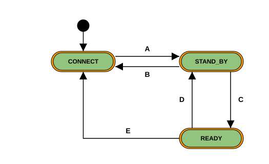

### **State Actions**

| State | Actions |
| :---- | :---- |
| CONNECT | Make a local socket connection to Node Manager. Raise ieLSConnectChange when connected successfully or fail. |
| STAND\_BY | Periodically sends Component Ready to Node Manager. Wait for Node Manager Ready. |
| READY | Periodically sends Component Ready to Node Manager. Check if Node Manager Ready timeout. Dispatch received messages to services. |

### **Internal Events**

| Event | Parameters | Purpose |
| :---- | :---- | :---- |
| ieLSConnectChange | Connected \= \[true | false\] | Indicate local socket connection state. |
| ieNodeManagerReady | Ready \= \[true | false\] | Indicate Node Manager Ready state. |
| ieSendMessage |  | Request to send the message |
| ieReceiveMessage |  | Dispatch received messages |

### **Transitions**

| Transition | Trigger | Condition | Action |
| :---- | :---- | :---- | :---- |
| A | ieLSConnectChange | Connected \= true |  |
| B | ieLSConnectChange | Connected \= false |  |
| C | ieNodeManagerReady | Ready \= true |  |
| D | ieNodeManagerReady | Ready \= false |  |
| E | ieLocalSocketConnect | Connected \= false |  |

## **Protocol**

### **Incoming Message Set**

| \# | ID | Message |
| :---- | :---- | :---- |
| 1 | H:0x00000001 L:0x00000102 | Report Link |
| 2 | H:0x00000001 L:0x00000104 | Node Manager Ready |

### **Outgoing Message Set**

| \# | ID | Message |
| :---- | :---- | :---- |
| 1 | H:0x00000001 L:0x00000101 | Query Link |
| 2 | H:0x00000001 L:0x00000103 | Component Ready |

## **Parameters**

1) CYCLEINTERVAL	double, time interval in seconds of each cycle, default=0.02.  
     
2) LOCALSOCKETFILEPATH	string, local socket file path used to connect to the Node Manager's local socket server, default="/tmp/ulils".  
     
3) CONNECTRETRYWAIT	double, time in seconds to wait before attempting a new local socket connection to the Node Manager, default=2.0.  
     
4) LINKTESTINTERVAL	double, time interval in seconds for checking the message round-trip time (RTT) between components via Query Link, default=150.0.  
     
5) LINKTESTDURATION	double, time duration in seconds that a link test session proceeds before computing average RTT, default=5.0.

6) NODEMANAGERREADYTIMEOUT	double, timeout in seconds for not receiving Node Manager Ready messages before disconnecting, default=5.0.  
     
7) COMPREADYRATE	double, time interval in seconds for sending Component Ready messages to the Node Manager, default=1.0.

##

# **Node Manager** [⬆️](#service-summary "Service Summary")

Node Manager service is the gateway to the outside world, routing UDP messages for the components within the node.

During startup, the Node Manager listens on a UDP port and joins a multicast group on both the global and subsystem network interfaces. It also sets up a local socket server, allowing the node's components to connect.

The Node Manager service requires a Node ID, which can be obtained either statically or dynamically. In the case of static Node ID acquisition, the Node Manager obtains the ID from the configuration and transitions directly from the STAND BY state to the READY state.

For dynamic Node ID acquisition, the Node Manager must request the ID from the Subsystem Manager service. After receiving the "Subsystem Manager Ready" message, the Node Manager sends a "Node ID Request" to the Subsystem Manager. The Subsystem Manager responds with a "Node ID Granted" message, assigning an ID to the Node Manager. The Node Manager transitions to the READY state once the "Node ID Granted" message is received, enabling it to send and receive other messages.

Require: none  
Inherit from: none

## **Service Behavior**

### **State Diagram**

### **State Actions**

| State | Actions |
| :---- | :---- |
| STAND\_BY | Wait for Subsystem Manager Ready Message, raise ieSubsytemManagerReady(true) |
| ACQUIRE\_ID | Periodically sends Node ID Request messages to Subsystem Manager service. Wait for Node ID Allocated messages, raise ieIDAcquired(NodeID). Check if SubsysteManagerReady timeout, raise ieSubsystemManagerReady(false) |
| READY | Periodically sends Node Ready messages to Subsystem Manager service. Periodically sends Node Manager Ready messages to all the components in the node. Check if Subsystem Manager Ready timeout. Route messages for components. |

### **Internal Events**

| Event | Parameters | Purpose |
| :---- | :---- | :---- |
| ieSubsystemManagerReady | Ready \= \[true | false\] | Indicate Subsystem Manager Ready state. |
| ieNodeIDAcquired | Node ID assigned | Indicate the Node ID is acquired. |
| ieSendMessage |  | Request to send message |
| ieReceiveMessage |  | Route received message |

### **Transitions**

| Transition | Trigger | Condition | Action |
| :---- | :---- | :---- | :---- |
| A | ieSubsystemManagerReady | Ready=true && Dynamic ID=true | Update subsystem ID |
| B | ieSubsystemManagerReady | Ready=false | Invalidate subsystem ID |
| C | ieSubsystemManagerReady | Ready=true && Dynamic ID=fale | Update subsystem ID |
| D | ieNodeIDAcquired | Valid Node ID assigned. | Update node ID. |
| E | ieSubsystemManagerReady | Ready \= false | Invalidate subsystem ID and Node ID. |

## **Protocol**

### **Incoming Message Set**

| \# | ID | Message |
| :---- | :---- | :---- |
| 1 | H:0x00000001 L:0x00000108 | Subsystem Manager Ready |
| 2 | H:0x00000001 L:0x00000107 | Node ID Granted |

### **Outgoing Message Set**

| \# | ID | Message |
| :---- | :---- | :---- |
| 1 | H:0x00000001 L:0x00000106 | Node ID Request |
| 2 | H:0x00000001 L:0x00000105 | Node Ready |
| 3 | H:0x00000001 L:0x00000104 | Node Manager Ready |

## **Parameters**

1) CYCLEINTERVAL	double, time interval in seconds of each cycle, default=0.02.  
     
2) GLOBALUDP	bool, whether to create global (inter-subsystem) UDP communications, default=false.  
     
3) GLOBALIF	string, ethernet interface name for global communications, default="".  
     
4) GLOBALIP	string, IP address for global communications, default="192.168.1.2". Note: if GLOBALIF is specified and resolves to a valid IP address, GLOBALIP is ignored.  
     
5) GLOBALMULTICAST	string, multicast address for broadcasting messages in global communications, default="239.255.0.1".  
     
6) SUBSYSUDP	bool, whether to create subsystem (intra-subsystem) UDP communications, default=false.  
     
7) SUBSYSIF	string, ethernet interface name for subsystem communications, default="".  
     
8) SUBSYSIP	string, IP address for subsystem communications, default="192.168.101.2". Note: if SUBSYSIF is specified and resolves to a valid IP address, SUBSYSIP is ignored.  
     
9) SUBSYSMULTICAST	string, multicast address for broadcasting messages in subsystem communications, default="239.255.0.2".  
     
10) LISTENINGPORT	string, UDP listening port for global and subsystem communications, default="13794".  
      
11) TTL	uint16, time-to-live of multicast packets, range \[1..255\], default=32.  
      
12) LOCALSOCKETFILEPATH	string, file path for the local socket server used to communicate with components in the node, default="/tmp/ulils".  
      
13) DYNAMICID	bool, whether to dynamically acquire the node ID from the Subsystem Manager (true) or use the configured NODEID (false), default=false.  
      
14) NODEID	uint16, static node ID of the Node Manager when DYNAMICID is false, range \[1..65534\], default=1.  
      
15) ACQUIREIDRATE	double, time interval in seconds for sending Node ID Request messages to the Subsystem Manager, default=1.0.  
      
16) NODEMANAGERREADYRATE	double, time interval in seconds for sending Node Manager Ready messages to all components in the node, default=1.0.  
      
17) NODEREADYRATE	double, time interval in seconds for sending Node Ready messages to the Subsystem Manager, default=1.0.  
      
18) SUBSYSTEMREADYTIMEOUT	double, timeout in seconds for not receiving Subsystem Manager Ready messages, default=10.0.  
      
19) COMPREADYTIMEOUT	double, timeout in seconds for not receiving Component Ready messages from a local component before removing its routing entry, default=10.0.  
      
20) COMPREADYCHECKINTERVAL	double, time interval in seconds for checking whether any local component's Component Ready heartbeat has timed out, default=2.0.

##

# **Subsystem Manager** [⬆️](#service-summary "Service Summary")

The Subsystem Manager resides on the Subsystem Node, with a Node ID of 1 and a Component ID of 2\.

It sends global broadcast "ID Request" messages to acquire its ID from the ID Allocator. After receiving an "ID Granted" message, the Subsystem Manager periodically broadcasts "Subsystem Manager Ready" messages to all Node Manager services within the subsystem.

Additionally, the Subsystem Manager periodically sends "Query Allocated ID" messages to the ID Allocator to ensure its assigned ID remains valid.

Require: none  
Inherit from: none

## **Service Behavior**

### **State Diagram**

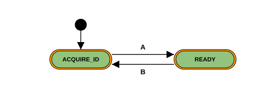

### **State Actions**

| State | Actions |
| :---- | :---- |
| ACQUIRE\_ID | Periodically sends ID Request messages to ID Allocator service. Wait for ID Granted messages, raise ieIDAcquired(true). |
| READY | Periodically sends subsystem-wide broadcast Subsystem Manager Ready messages. Periodically sends Query Allocated ID to ID Allocator. Check if Report Allocated ID is received. If not, raise ieIDAcquired(false). Route received messages for the subsystem node. |

### **Internal Events**

| Event | Parameters | Purpose |
| :---- | :---- | :---- |
| ieIDAcquired |  |  |
| ieNodeReady |  | Notify node is (not) ready |
| ieReceiveMessage |  | Route received message |

### **Transitions**

| Transition | Trigger | Condition | Action |
| :---- | :---- | :---- | :---- |
| A | ieIDAcquired | true | Update the subsystem ID |
| B | ieIDAcquired | false | Invalidate the subsystem ID |

## **Protocol**

### **Incoming Message Set**

| \# | ID | Message |
| :---- | :---- | :---- |
| 1 | H:0x00000001 L:0x0000010B | ID Granted |
| 2 | H:0x00000001 L:0x0000010C | Report Allocated ID |

### **Outgoing Message Set**

| \# | ID | Message |
| :---- | :---- | :---- |
| 1 | H:0x00000001 L:0x00000109 | ID Request |
| 2 | H:0x00000001 L:0x0000010A | Query Allocated ID |
| 3 | H:0x00000001 L:0x00000108 | Subsystem Manager Ready |

## **Parameters**

1) CYCLEINTERVAL	double, time interval in seconds of each cycle, default=0.1.  
     
2) DYNAMICID	bool, whether to dynamically acquire the subsystem ID from the ID Allocator (true) or use the static SUBSYSTEMID (false), default=false.  
     
3) SUBSYSTEMID	uint32, static subsystem ID when DYNAMICID is false, range \[1..65534\], default=3.  
     
4) SUBSYSTEMTYPE	string, type of the subsystem \["UNKNOWN" | "NEURO\_NETWORK" | "WAREHOUSE" | "MANUFACTURING" | "UNMANNED\_VEHICLE" | "SENSOR\_NETWORK" | "CONTROLLER" | "META\_HUMAN"\], default="UNKNOWN".  
     
5) ACQUIREIDRATE	double, time interval in seconds for sending ID Request messages to the ID Allocator, default=1.0.  
     
6) QUERYIDRATE	double, time interval in seconds for sending Query Allocated ID messages to verify the allocated subsystem ID with the ID Allocator, default=2.0.  
     
7) SUBSYSTEMMANAGERREADYRATE	double, time interval in seconds for broadcasting Subsystem Manager Ready messages to all nodes in the subsystem, default=1.0.  

8) REPORTIDTIMEOUT	double, timeout in seconds for not receiving Report Allocated ID messages from the ID Allocator, default=10.0.

9) NODEREADYTIMEOUT	double, timeout in seconds for not receiving Node Ready messages from an allocated node before reclaiming its node ID, default=10.0.  
     
10) NODEREADYCHECKINTERVAL	double, time interval in seconds for checking whether any node's Node Ready heartbeat has timed out, default=2.0.  
      
11) STARTINGID	uint16, the first node ID in the range \[STARTINGID..ENDINGID\] available for dynamic allocation to nodes, default=2.  
      
12) ENDINGID	uint16, the last node ID in the range \[STARTINGID..ENDINGID\] available for dynamic allocation (if ENDINGID \< STARTINGID, dynamic node ID allocation is disabled), default=0.

##

# **ID Allocator** [⬆️](#service-summary "Service Summary")

The ID Allocator service is responsible for assigning IDs to Subsystem Managers. Upon receiving globally broadcast "ID Request" messages, the ID Allocator assigns an ID and responds with an "ID Granted" message to the requester.

The ID Allocator also supports "Query/Report Allocated ID" functionality, allowing clients to query allocated IDs based on subsystem types or MAC addresses. Clients should periodically query the allocated subsystem ID to ensure it is still valid. If the client's ID is not included in the returned list, the Subsystem Manager will cease broadcasting "Subsystem Manager Ready" messages.

Require: none  
Inherit from: none

## **Service Behavior**

### **State Diagram**

### **State Actions**

| State | Actions |
| :---- | :---- |
| READY | Assign ID when receiving Subsystem ID Request. Send Report Allocated Subsystem ID when receiving Query Allocated Subsystem ID. |

### **Internal Events**

| Event | Parameters | Purpose |
| :---- | :---- | :---- |
| ieReceiveIDRequest |  |  |
| ieReceiveQueryAllocatedID |  |  |

### **Transitions**

| Transition | Trigger | Condition | Action |
| :---- | :---- | :---- | :---- |
| A | ieReceiveIDRequest |  |  |
| A | ieReceiveQueryAllocatedID |  | Send Report Allocated ID |

## **Protocol**

### **Incoming Message Set**

| \# | ID | Message |
| :---- | :---- | :---- |
| 1 | H:0x00000001 L:0x00000109 | ID Request |
| 2 | H:0x00000001 L:0x0000010A | Query Allocated ID |

### **Outgoing Message Set**

| \# | ID | Message |
| :---- | :---- | :---- |
| 1 | H:0x00000001 L:0x0000010B | ID Granted |
| 2 | H:0x00000001 L:0x0000010C | Report Allocated ID |

## **Parameters**

1) CYCLEINTERVAL	double, time interval in seconds of each cycle, default=0.1.  
     
2) STARTINGID	uint32, the first subsystem ID in the range \[STARTINGID..ENDINGID\] to allocate to requesting subsystems, default=1.  
     
3) ENDINGID	uint32, the last subsystem ID in the range \[STARTINGID..ENDINGID\] to allocate (if ENDINGID \< STARTINGID, no subsystem IDs are allocated), default=0.

##

# **Discovery** [⬆️](#service-summary "Service Summary")

The Discovery service enables components to register their services and allows clients to locate these services. It is implemented alongside the Subsystem Manager service.

Require: none  
Inherit from: none

## **Service Behavior**

### **State Diagram**

### **State Actions**

| State | Actions |
| :---- | :---- |
| READY | Store registered services Report services and service list |

### **Internal Events**

| Event | Parameters | Purpose |
| :---- | :---- | :---- |
| ieReceiveMessage |  | Indicate a message is received |

### **Transitions**

| Transition | Trigger | Condition | Action |
| :---- | :---- | :---- | :---- |
| A | ieReceiveMessage |  | Process received message |

## **Protocol**

### **Incoming Message Set**

| \# | ID | Message |
| :---- | :---- | :---- |
| 1 | H:0x00000001 L:0x0000010D | Query Identification |
| 2 | H:0x00000001 L:0x0000010E | Register Comp Services |
| 3 | H:0x00000001 L:0x0000010F | Query Comp Services |
| 4 | H:0x00000001 L:0x00000110 | Query Subsystem Services |

### **Outgoing Message Set**

| \# | ID | Message |
| :---- | :---- | :---- |
| 1 | H:0x00000001 L:0x00000111 | Report Identification |
| 2 | H:0x00000001 L:0x00000112 | Report Comp Services |
| 3 | H:0x00000001 L:0x00000113 | Report Subsystem Services |

## **Parameters**

1) CYCLEINTERVAL	double, time interval in seconds of each cycle, default=0.1.  
     
2) SUBSYSTEMTYPE	string, type of the subsystem reported in Report Identification \["UNKNOWN" | "NEURO\_NETWORK" | "WAREHOUSE" | "MANUFACTURING" | "UNMANNED\_VEHICLE" | "SENSOR\_NETWORK" | "CONTROLLER" | "META\_HUMAN"\], default="UNKNOWN".  
     
3) SUBSYSTEMURI	string, URI identifying this subsystem in Report Identification, default="asset.ovt.com".  
     
4) DATATIMEOUT	double, timeout in seconds for not receiving Register Comp Services updates from a component before expiring its registered services, default=10.0.  
     
5) DATACHECKINTERVAL	double, time interval in seconds for checking registered component services for timeout, default=2.0.

6) REQUIREDACCESSRIGHT	string, minimum data access right \["UNKNOWN" | "NOT\_ALLOWED" | "UNCLASSIFIED" | "CONTROLLED" | "CLASSIFIED"\] required in Query Identification to receive a Report Identification response, default="NOT\_ALLOWED".

7) CONTEXTFILENAME	string, name of the markdown file in the component's working directory containing the context of the subsystem reported in Report Identification, default="context.md".

8) PROFILEIMAGEFILENAME	string, name of the JPEG file (".jpg" or ".jpeg") in the component's working directory containing the profile image of the subsystem reported in Report Identification, default="profile.jpg".

##

# **Service Register** [⬆️](#service-summary "Service Summary")

The Service Register periodically registers the component's services with the Discovery service.

Require: none  
Inherit from: none

## **Service Behavior**

### **State Diagram**

### **State Actions**

| State | Actions |
| :---- | :---- |
| READY | Periodically sends Register Services to the Discovery service. |

### **Internal Events**

| Event | Parameters | Purpose |
| :---- | :---- | :---- |
|  |  |  |

### **Transitions**

| Transition | Trigger | Condition | Action |
| :---- | :---- | :---- | :---- |
| A | ieReceiveMessage |  | Process received message |

## **Protocol**

### **Incoming Message Set**

| \# | ID | Message |
| :---- | :---- | :---- |

### **Outgoing Message Set**

| \# | ID | Message |
| :---- | :---- | :---- |
| 1 | H:0x00000001 L:0x0000010E | Register Comp Services |

## **Parameters**

1) CYCLEINTERVAL	double, time interval in seconds of each cycle, default=0.1.  
     
2) REGISTERINTERVAL	double, time interval in seconds for periodically sending Register Comp Services messages to the Discovery service, default=2.0.

##

# **Status Reporter** [⬆️](#service-summary "Service Summary")

The Status Reporter service periodically sends the component’s status to the subsystem's Status Monitor service.

Require: none  
Inherit from: none

## **Service Behavior**

### **State Diagram**

### **State Actions**

| State | Actions |
| :---- | :---- |
| READY | Periodically report status details to subsystem manager. |

### **Internal Events**
| Event | Parameters | Purpose |
| :---- | :---- | :---- |
| ieReceiveMessage |  |  |

### **Transitions**

| Transition | Trigger | Condition | Action |
| :---- | :---- | :---- | :---- |
| A | ieReceiveMessage |  | Process received message |

## **Protocol**

### **Incoming Message Set**

| \# | ID | Message |
| :---- | :---- | :---- |
| 1 | H:0x00000001 L:0x00000114 | Query Comp Health |
| 2 | H:0x00000001 L:0x00000116 | Query Comp Status Details |

      2. ### **Outgoing Message Set** {#outgoing-message-set-6}

| \# | ID | Message |
| :---- | :---- | :---- |
| 1 | H:0x00000001 L:0x00000115 | Report Comp Health |
| 2 | H:0x00000001 L:0x00000117 | Report Comp Status Details |
| 3 | H:0x00000001 L:0x00000118 | Register Comp Health |
| 4 | H:0x00000001 L:0x00000119 | Register Comp Status Details |
| 5 | H:0x00000001 L:0x0000011A | Register Comp Health Context |

## **Parameters**

1) CYCLEINTERVAL	double, time interval in seconds of each cycle, default=0.1.  
     
2) REGISTERHEALTHINTERVAL	double, time interval in seconds for sending Register Comp Health messages to the Status Monitor, default=2.0.  
     
3) REGISTERSTATUSDETAILSINTERVAL	double, time interval in seconds for sending Register Comp Status Details messages to the Status Monitor, default=2.0.  
     
4) REGISTERHEALTHCONTEXTINTERVAL	double, time interval in seconds for sending Register Comp Health Context messages to the Status Monitor, default=10.0.  
     
5) HEALTHCONTEXTFILENAME	string, name of the markdown file in the component's working directory containing the component's health context description, default="health_context.md".

##

# **Status Monitor** [⬆️](#service-summary "Service Summary")

The Status Monitor service allows Status Reporter services to submit component status updates. Status Monitor service is implemented alongside the Subsystem Manager service to offer status information for all components within the subsystem.

Require: none  
Inherit from: none

## **Service Behavior**

### **State Diagram**

### **State Actions**

| State | Actions |
| :---- | :---- |
| READY | Receive Report Status Details from components of the subsystem. Response to Query Status Details List |

### **Internal Events**

| Event | Parameters | Purpose |
| :---- | :---- | :---- |
| ieReceiveMessage |  |  |

### **Transitions**

| Transition | Trigger | Condition | Action |
| :---- | :---- | :---- | :---- |
| A | ieReceiveMessage |  | Process received message |

## **Protocol**

### **Incoming Message Set**

| \# | ID | Message |
| :---- | :---- | :---- |
| 1 | H:0x00000001 L:0x0000011B | Query Subsystem Management States |
| 2 | H:0x00000001 L:0x0000011C | Query Subsystem Health |
| 3 | H:0x00000001 L:0x0000011D | Query Subsystem Status Details |
| 4 | H:0x00000001 L:0x0000011E | Query Subsystem Health Context |
| 5 | H:0x00000001 L:0x00000118 | Register Comp Health |
| 6 | H:0x00000001 L:0x00000119 | Register Comp Status Details |
| 7 | H:0x00000001 L:0x0000011A | Register Comp Health Context |

### **Outgoing Message Set**

| \# | ID | Message |
| :---- | :---- | :---- |
| 1 | H:0x00000001 L:0x0000011F | Report Subsystem Management States |
| 2 | H:0x00000001 L:0x00000120 | Report Subsystem Health |
| 3 | H:0x00000001 L:0x00000121 | Report Subsystem Status Details |
| 4 | H:0x00000001 L:0x00000122 | Report Subsystem Health Context |

## **Parameters**

1) CYCLEINTERVAL	double, time interval in seconds of each cycle, default=0.1.  
     
2) SUBSYSTEMURI	string, URI of the subsystem included in Report Subsystem Health, Report Subsystem Status Details, and Report Subsystem Health Contexts, default="ulikaya.ovt.com".  
     
3) HEALTHTIMEOUT	double, timeout in seconds for not receiving Register Comp Health updates from a component, default=5.0.  
     
4) STATUSDETAILSTIMEOUT	double, timeout in seconds for not receiving Register Comp Status Details updates from a component, default=5.0.  
     
5) HEALTHCONTEXTTIMEOUT	double, timeout in seconds for not receiving Register Comp Health Context updates from a component, default=30.0.  
     
6) DATACHECKINTERVAL	double, time interval in seconds for checking whether component health, status details, or health context records have timed out, default=2.0.

##

# **Subsystem Access** [⬆️](#service-summary "Service Summary")

The Subsystem Access service allows multiple clients to obtain data topics from the subsystem. Clients periodically send "Request Subsystem Access" messages. Upon receiving a request, the Subsystem Access service determines the client's data access rights and responds with a "Confirm Subsystem Access" message, which includes the session UUID and access permissions.

Additionally, the Subsystem Access service sends a "Set Access" message to the Comp Access service to inform components of the clients' data access rights.

Require: none  
Inherit from: none

## **Service Behavior**

### **State Diagram**

### **State Actions**

| State | Actions |
| :---- | :---- |
| READY |  |

### **Internal Events**

| Event | Parameters | Purpose |
| :---- | :---- | :---- |
| ieReceiveMessage |  |  |

### **Transitions**

| Transition | Trigger | Condition | Action |
| :---- | :---- | :---- | :---- |
| A | ieReceiveMessage |  | Process received message |

## **Protocol**

### **Incoming Message Set**

| \# | ID | Message |
| :---- | :---- | :---- |
| 1 | H:0x00000001 L:0x00000123 | Request Subsystem Access |
| 2 | H:0x00000001 L:0x00000113 | Report Subsystem Services |

### **Outgoing Message Set**

| \# | ID | Message |
| :---- | :---- | :---- |
| 1 | H:0x00000001 L:0x00000124 | Confirm Subsystem Access |
| 2 | H:0x00000001 L:0x00000125 | Set Access |
| 3 | H:0x00000001 L:0x00000110 | Query Subsystem Services |

## **Parameters**

1) CYCLEINTERVAL	double, time interval in seconds of each cycle, default=0.1.  
     
2) SESSIONTIMEOUT	double, timeout in seconds for not receiving Request Subsystem Access messages from a client before expiring its access session, default=10.0.  
     
3) CHECKSESSIONINTERVAL	double, time interval in seconds for checking expired client access sessions and rolling the session counter, default=5.0.  
     
4) QUERYSERVICESINTERVAL	double, time interval in seconds for sending Query Subsystem Services messages to the Discovery service to discover CompAccess services, default=5.0.  
     
5) SETACCESSINTERVAL	double, time interval in seconds for broadcasting Set Access messages to all CompAccess services in the subsystem, default=3.0.  
     
6) REPORTTIMEOUT	double, timeout in seconds for not receiving Report Subsystem Services updates from the Discovery service, default=30.0.

##

# **Subsystem Control** [⬆️](#service-summary "Service Summary")

The Subsystem Control service manages exclusive control over the subsystem. A client must first obtain control of the Subsystem before it can exclusively utilize the services provided by the subsystem’s components.

The Subsystem Control service periodically sends "Set Control Session" messages to the Comp Control service to inform components of the current exclusive client's session. If control has been granted to the client, the "Set Control Session" message includes the client's session UUID. Otherwise, the message contains the default session UUID of the Subsystem Control service.

Require: none  
Inherit from: none

## **Service Behavior**

### **State Diagram**

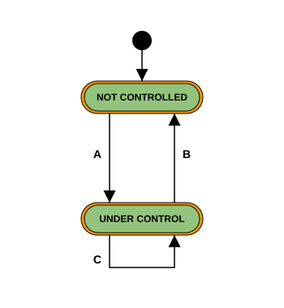

### **State Actions**

| State | Actions |
| :---- | :---- |
| NOT CONTROLLED | Subsystem broadcast the default session Uuid to all the access control services. |
| UNDER CONTROL | Subsystem broadcast the session Uuid to all the access control services. The client, CCU, is required to obtain control before it can gain control from the Access Control services. |

### **Internal Events**

| Event | Parameters | Purpose |
| :---- | :---- | :---- |
| ieReceiveMessage |  | Process messages |

### **Transitions**

| Transition | Trigger | Condition | Action |
| :---- | :---- | :---- | :---- |
| A | Request Subsystem Control is received and certificates of the client are verified. | Certificate of the client is verified. | Save the controlling client and sends Confirm Subsystem Control. |
| B | Release Subsystem Control is received.  | Sender is the controlling client | Clear the controlling client and sends Reject Subsystem Control. |
| B | Subsystem Control timeout. | Does not receive Request Subsystem Control from the client | Clear the controlling client and sends Reject Subsystem Control. |
| C | Request Subsystem Control is received within timeout. | Sender is the controlling client and certificate of the client is verified |  |

## **Protocol**

### **Incoming Message Set**

| \# | ID | Message |
| :---- | :---- | :---- |
| 1 | H:0x00000001 L:0x00000126 | Query Subsystem Control Status |
| 2 | H:0x00000001 L:0x00000128 | Request Subsystem Control |
| 3 | H:0x00000001 L:0x00000129 | Release Subsystem Control |
| 4 | H:0x00000001 L:0x0000012A | Request Handover |
| 5 | H:0x00000001 L:0x00000113 | Report Subsystem Services |

### **Outgoing Message Set**

| \# | ID | Message |
| :---- | :---- | :---- |
| 1 | H:0x00000001 L:0x00000127 | Report Subsystem Control Status |
| 2 | H:0x00000001 L:0x0000012B | Confirm Subsystem Control |
| 3 | H:0x00000001 L:0x0000012C | Set Control Session |
| 4 | H:0x00000001 L:0x0000012D | Request Release |
| 5 | H:0x00000001 L:0x0000012E | Reject Subsystem Control |
| 6 | H:0x00000001 L:0x00000110 | Query Subsystem Services |

## **Parameters**

1) CYCLEINTERVAL	double, time interval in seconds of each cycle, default=0.1.

2) SUBSYSTEMCONTROLTIMEOUT	double, timeout in seconds for not receiving Request Subsystem Control messages from the controlling client before releasing control, default=2.0.  
     
3) DEFAULTAUTHORITY	uint8, minimum authority code required for a client to acquire subsystem control, default=1.  
     
4) QUERYSERVICESINTERVAL	double, time interval in seconds for sending Query Subsystem Services messages to the Discovery service to discover CompControl services, default=5.0.  
     
5) SETSESSIONINTERVAL	double, time interval in seconds for sending Set Control Session messages to all CompControl services in the subsystem, default=0.5.  
     
6) REPORTTIMEOUT	double, timeout in seconds for not receiving Report Subsystem Services updates from the Discovery service, default=30.0.

##

# **Comp Access** [⬆️](#service-summary "Service Summary")

The Comp Access service enables multiple clients to obtain app data or data topics from a component. Clients must present the session UUID when querying or subscribing to data.

The Comp Access service periodically receives "Set Access" messages from the Subsystem Access service, which contain a list of access records. The Comp Access service updates the component with these access records.

Require: none  
Inherit from: none

## **Service Behavior**

### **State Diagram**

### **State Actions**

| State | Actions |
| :---- | :---- |
| READY |  |

### **Internal Events**

| Event | Parameters | Purpose |
| :---- | :---- | :---- |
| ieReceiveMessage |  |  |

### **Transitions**

| Transition | Trigger | Condition | Action |
| :---- | :---- | :---- | :---- |
| A | ieReceiveMessage |  | Process received message |

## **Protocol**

### **Incoming Message Set**

| \# | ID | Message |
| :---- | :---- | :---- |
| 1 | H:0x00000001 L:0x00000125 | Set Access |

### **Outgoing Message Set**

| \# | ID | Message |
| :---- | :---- | :---- |
|  |  |  |

## **Parameters**

1) CYCLEINTERVAL	double, time interval in seconds of each cycle, default=0.1.  
     
2) SESSIONTIMEOUT	double, timeout in seconds for expiring stored client access records when Set Access updates are not received from SubsystemAccess, default=10.0.

##

# **Comp Control** [⬆️](#service-summary "Service Summary")

The Comp Control service ensures exclusive control over the services provided by a component. A client is granted control if it presents a matching session UUID and has the highest authority code. Once granted control, only command messages from the controlling client are processed.

The Comp Control service periodically receives the Session UUID broadcasted by the Subsystem Control service. If the Session UUID is not received, the Comp Control service sends a "Reject Control" message to the controlling client.

To maintain control, the controlling client must periodically send "Request Control" messages. If the Comp Control service does not receive a "Request Control" message from the controlling client within a specified timeout period, it sends a "Reject Control" message, indicating that control has been lost.

A client with a higher authority code can take control from the current controlling client. In this case, a "Reject Control" message is sent to the current controlling client, and a "Confirm Control" message is sent to the client with the higher authority code.

The controlling client can also send a "Release Control" message to relinquish control. In this scenario, the "Reject Control" message is sent to confirm that the client no longer has control.

Control is not available if the component is in Emergency mode due to the Management service being in Emergency. During this time, no new control is granted, and the existing controlling client retains control.

Require: none  
Inherit from: none

## **Service Behavior**

### **State Diagram**

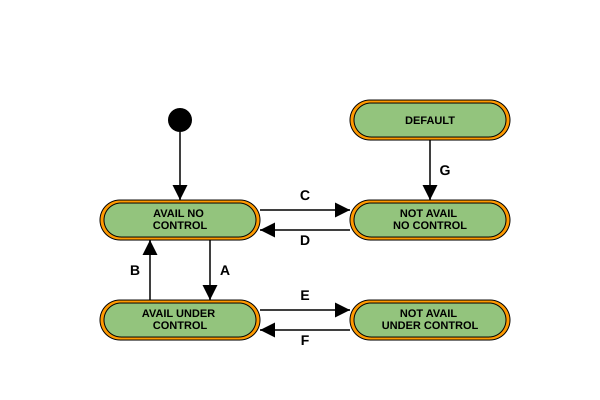

### **State Actions**

| State | Actions |
| :---- | :---- |
| AVAIL NO CONTROL | Response to Request Control |
| AVAIL UNDER CONTROL | Process command messages from the controlling client |
| NOT AVAIL NO CONTROL | Comp control is not available due to the status of the comp is in emergency or Session UUID timeout. |
| NOT AVAIL UNDER CONTROL | Comp control is not available due to the status of the comp is in emergency. The command messages from the controlling client is not processed. However, the controlling client remains in control. |

### **Internal Events**

| Event | Parameters | Purpose |
| :---- | :---- | :---- |
| ieEmergency | emergency \= \[set | clear\] | Transition to NOT AVAIL NO CONTROL or NOT AVAIL UNDER CONTROL if set. OR Transition to AVAIL NO CONTRO or AVAIL UNDER CONTROL. |
| ieShutdown |  | Transition to NOT AVAIL NO CONTROL |
| ieRenderUseless |  | Transition to NOT AVAIL NO CONTROL |
| ieReceiveMessage |  | Process messages: Query Control, Request Control, and Release Control. |

### **Transitions**

| Transition | Trigger | Condition | Action |
| :---- | :---- | :---- | :---- |
| A | Request Control received and its authority code \> current authority. | Session UUID valid | Sender becomes the client of the service. The current authority is to the authority code of the Request Control message. |
| B | Timeout – No Request Control is received within control timeout. Released – Release control is received from the client. | Session UUID valid | Set current authority to default authority. |
| C | ieEmergency(set) |  |  |
| D | ieEmergency(clear) |  |  |
| E | ieEmergency(set) |  |  |
| F | ieEmergency(clear) |  |  |
| G | Session UUID |  | Invalidate Session UUID and client. Send Reject Control to the controlling client. |
| G | ieShutdow or ieRenderUseless received |  | Invalidate Session UUID and client. Send Reject Control to the controlling client. |

## **Protocol**

### **Incoming Message Set**

| \# | ID | Message |
| :---- | :---- | :---- |
| 1 | H:0x00000001 L:0x0000012F | Request Control |
| 2 | H:0x00000001 L:0x00000130 | Release Control |
| 3 | H:0x00000001 L:0x00000131 | Query Control |
| 4 | H:0x00000001 L:0x0000012C | Set Session Uuid |

### **Outgoing Message Set**

| \# | ID | Message |
| :---- | :---- | :---- |
| 1 | H:0x00000001 L:0x00000132 | Confirm Control |
| 2 | H:0x00000001 L:0x00000133 | Reject Control |
| 3 | H:0x00000001 L:0x00000134 | Report Control |

## **Parameters**

1) CYCLEINTERVAL	double, time interval in seconds of each cycle, default=0.1.  
     
2) DEFAULTAUTHORITY	uint8, minimum authority code required for a client to acquire component control, default=1.  
     
3) SESSIONTIMEOUT	double, timeout in seconds for not receiving Set Control Session updates from SubsystemControl, default=2.0.  
     
4) CONTROLTIMEOUT	double, timeout in seconds for not receiving Request Control messages from the controlling client before releasing control, default=2.0.  
     
5) CHECKSESSIONINTERVAL	double, time interval in seconds for checking whether the control session UUID has timed out, default=0.5.  
     
6) CHECKCONTROLINTERVAL	double, time interval in seconds for checking whether Request Control from the controlling client has timed out, default=0.5.

##

# **Management** [⬆️](#service-summary "Service Summary")

The Management service oversees the lifecycle of a component. 

The Management service and the Subsystem State service influence each other's state transitions. When the Subsystem State service is in the “Initializing” state, it broadcasts RESET commands to all Management services, causing their state to transition to INITIALIZE.

In the “Emergency” state, the Subsystem State service broadcasts emergency commands to all Management services, resulting in their state transitioning to EMERGENCY.

The Management service transitions to the PAUSE state when a pause condition is detected and reverts to the CONTINUE state once the pause condition is resolved.

The Subsystem State service transitions to the “pause” state if any Management service within the subsystem is in PAUSE. It returns to the “operational” state only when all Management services are in the CONTINUE state.

The Management service operates in conjunction with the Comp Control service, ensuring that only the controlling client is authorized to send commands to change its state.

Commands from the controlling client to the services hosted by the component are executed only when the Management service is in the READY state. The controlling client must send a GO command to keep the Management service in the READY state.

Require: Comp Control service  
Inherit from: none

## **Service Behavior**

### **State Diagram**

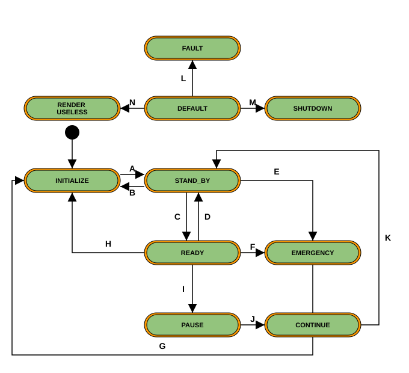

### **State Actions**

| State | Actions |
| :---- | :---- |
| INITIALIZE | Perform initialize procedures |
| STAND BY | Initialization complete, waiting for RESUME message |
| READY | Execute commands |
| EMERGENCY | Handle emergency condition |
| PAUSE | Detect and handle pause condition |
| CONTINUE | Waiting to resume back to standby |
| FATAL | Unrecoverable error |
| SHUTDOWN | Shut down |
| RENDER USELESS | Become not useable |

### **Internal Events**

| Event | Parameters | Purpose |
| :---- | :---- | :---- |
| ieReceiveMessage |  | Process messages: Reset, Resume, Emergency, and Query Status. |
| ieEmergency | emergency \= \[set | clear\] | Raise when transition to EMERGENCY, or when transition to STAND BY from EMERGENCY |
| ieShutdown |  | Raise when transition to SHUTDOWN |
| ieRenderUseless |  | Raise when transition to RENDER USELESS. |

### **Transitions**

Note: All the transitions will update the management state of the component.

| Transition | Trigger | Condition | Action |
| :---- | :---- | :---- | :---- |
| A | Complete initialization procedures and Start Received |  |  |
| B | Reset received |  |  |
| C | Go received | Access Control |  |
| D | Go timeout | Access Control |  |
| E | Set Emergency received |  | Access control service transitions to Not Available. |
| F | Set Emergency received |  | Access control service transitions to Not Available. |
| G | Clear Emergency received |  | Access control service transitions to Available. |
| H | Reset received | Access Control |  |
| I | Pause condition detected |  |  |
| J | Pause condition does not exist |  |  |
| K | Resume received |  |  |
| L | Shutdown received or encounter fatal error |  |  |
| M | Render Useless |  |  |

## **Protocol**

### **Incoming Message Set**

| \# | ID | Message |
| :---- | :---- | :---- |
| 1 | H:0x00000001 L:0x00000135 | Reset |
| 2 | H:0x00000001 L:0x00000136 | Start |
| 3 | H:0x00000001 L:0x00000137 | Go |
| 4 | H:0x00000001 L:0x00000138 | Set Emergency |
| 5 | H:0x00000001 L:0x00000139 | Clear Emergency |
| 6 | H:0x00000001 L:0x0000013A | Pause |
| 7 | H:0x00000001 L:0x0000013B | Resume |
| 8 | H:0x00000001 L:0x0000013C | Shutdown |
| 9 | H:0x00000001 L:0x0000013D | Render Useless |
| 10 | H:0x00000001 L:0x0000013E | Query Management State |

### **Outgoing Message Set**

| \# | ID | Message |
| :---- | :---- | :---- |
| 1 | H:0x00000001 L:0x0000013F | Report Management State |

## **Parameters**

1) CYCLEINTERVAL	double, time interval in seconds of each cycle, default=0.1.  
     
2) GOTIMEOUT	double, timeout in seconds for not receiving Go messages in the READY state before transitioning to STANDBY, default=2.0.  
     
3) CHECKPAUSEINTERVAL	double, time interval in seconds for checking whether pause conditions exist while in the READY or PAUSE state, default=2.0.

##

# **Subsystem State** [⬆️](#service-summary "Service Summary")

The Subsystem State service manages the lifecycle of the subsystem. The controlling client, whether the Operator Control Unit or Safety service, can set the state of the Subsystem State service to INITIALIZING, OPERATIONAL, EMERGENCY, SHUTDOWN, or RENDER USELESS.

As described for the Management service, the Subsystem State service sends commands to Management services to align their states with that of the Subsystem State service.

Conversely, the Subsystem State service monitors the states of the Management services. It transitions to the PAUSE state if any Management service is in “pause” state. It reverts to the OPERATIONAL state only when all Management services are in “continue” state. In the OPERATIONAL state, the Subsystem State service sends a RESUME command to prompt Management services to transition from “continue” to “stand-by” state.

Note that the client must have exclusive control of the Subsystem State service to change its state.

Require: Comp Control service  
Inherit from: none

## **Service Behavior**

### **State Diagram**

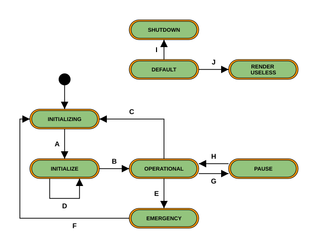

### **State Actions**

| State | Actions |
| :---- | :---- |
| INITIALIZING | Subsystem broadcasts Reset to all the management services to have them transitioning to INITIALIZE state. |
| INITIALIZE | Subsystem broadcasts Start to all the management services to have them transitioning to STANDBY state. |
| OPERATIONAL | Indicate the Subsystem is capable of process commands. Client sends Go message to the management services. |
| EMERGENCY | Subsystem broadcasts Set Emergency to all the management services to have them transitioning to EMERGENCY state. |
| PAUSE | Subsystem broadcasts Pause to all the management services to have them transitioning to Pause. |
| SHUTDOWN | Subsystem broadcasts SHUTDOWN to all the management services to have them transitioning to SHUTDOWN state. |
| RENDER USELESS | Subsystem broadcasts RENDER USELESS to all the management services to have them transitioning to RENDER USELESS state |

### **Internal Events**

| Event | Parameters | Purpose |
| :---- | :---- | :---- |
| ieReceiveMessage |  | Process messages |

### **Transitions**

| Transition | Trigger | Condition | Action |
| :---- | :---- | :---- | :---- |
| A | All of management services in the subsystem are in INITIALIZE state |  |  |
| B | All of the management services in the subsystem are in either STANDBY or READY state. |  |  |
| C | Set Subsystem State (Reset) is received. | Message is from controlling client |  |
| D | Set Subsystem State (Emergency) is received. | Message is from controlling client |  |
| E | Set Subsystem State (Emergency) is received. | Message is from controlling client |  |
| F | Emergency condition is cleared. Set Operational message is received. | Message is from controlling client |  |
| G | One of the management services is in PAUSE state |  | Send PAUS to all the management services. |
| H | All the management services in the subsystem are in CONTINUE state. |  |  |
| I | Set Subsystem State (Shutdown) is received. | Message is from controlling client |  |
| J | Set Subsystem State (Render Useless) is received. | Message is from controlling client |  |

## **Protocol**

### **Incoming Message Set**

| \# | ID | Message |
| :---- | :---- | :---- |
| 1 | H:0x00000001 L:0x00000140 | Set Subsystem State |
| 2 | H:0x00000001 L:0x00000141 | Query Subsystem State |
| 3 | H:0x00000001 L:0x0000011F | Report Subsystem Management States |
| 4 | H:0x00000001 L:0x00000113 | Report Subsystem Services |

      2. ### **Outgoing Message Set** {#outgoing-message-set-13}

| \# | ID | Message |
| :---- | :---- | :---- |
| 1 | H:0x00000001 L:0x00000142 | Report Subsystem State |
| 2 | H:0x00000001 L:0x0000011B | Query Subsystem Management States |
| 3 | H:0x00000001 L:0x00000110 | Query Subsystem Services |
| 4 | H:0x00000001 L:0x00000135 | Reset |
| 5 | H:0x00000001 L:0x00000136 | Start |
| 6 | H:0x00000001 L:0x00000138 | Set Emergency |
| 7 | H:0x00000001 L:0x00000139 | Clear Emergency |
| 8 | H:0x00000001 L:0x0000013A | Pause |
| 9 | H:0x00000001 L:0x0000013B | Resume |

## **Parameters**

1) CYCLEINTERVAL	double, time interval in seconds of each cycle, default=0.02.  
     
2) SETCOMMANDTIMEOUT	double, timeout in seconds for not receiving Set Subsystem State commands before reverting from ACTIVE to STAND\_BY, default=2.0.  
     
3) CHECKINTERVAL	double, time interval in seconds to check the management states of all components in the subsystem, default=0.5.  
     
4) QUERYMANAGEMENTSTATEINTERVAL	double, time interval in seconds for sending Query Subsystem Management States to the Status Monitor, default=0.5.  
     
5) QUERYSERVICESINTERVAL	double, time interval in seconds for sending Query Subsystem Services to the Discovery service, default=2.0.  
     
6) MESSAGEINTERVAL	double, time interval in seconds for sending state transition messages (Reset, Start, Go, Pause, Resume, Set Emergency, Clear Emergency) to Management services, default=0.5.  
     
7) REPORTTIMEOUT	double, timeout in seconds for not receiving Report Subsystem Management States or Report Subsystem Services updates, default=10.0.

##

# **Subsystem Operating Mode** [⬆️](#service-summary "Service Summary")

The Subsystem Operating Mode service provides an interface for the client to set the operating mode of the subsystem. Once the operating mode is set, this service broadcasts the operating mode to all the Comp Operating Mode services within the subsystem.

The operating modes are defined as follows:

* UNKNOWN  
* STANDARD\_OPERATING  
* COMBAT  
* SILENT\_WATCH  
* SILENT\_MOVE  
* TRAINING  
* MAINTENANCE

Require: Subsystem Control service  
Inherit from: none

## **Service Behavior**

### **State Diagram**

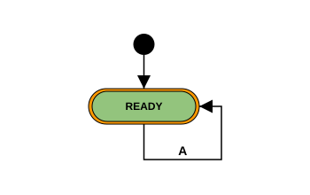

### **State Actions**

| State | Actions |
| :---- | :---- |
| READY |  |

### **Internal Events**

| Event | Parameters | Purpose |
| :---- | :---- | :---- |
| ieReceiveMessage |  |  |

### **Transitions**

| Transition | Trigger | Condition | Action |
| :---- | :---- | :---- | :---- |
| A | ieReceiveMessage |  | Process received message |

## **Protocol**

### **Incoming Message Set**

| \# | ID | Message |
| :---- | :---- | :---- |
| 1 | H:0x00000001 L:0x00000144 | Set Operating Mode |
| 2 | H:0x00000001 L:0x00000145 | Query Operating Mode |
| 3 | H:0x00000001 L:0x00000113 | Report Subsystem Services |

### **Outgoing Message Set**

| \# | ID | Message |
| :---- | :---- | :---- |
| 1 | H:0x00000001 L:0x00000146 | Report Operating Mode |
| 2 | H:0x00000001 L:0x00000110 | Query Subsystem Services |

## **Parameters**

1) CYCLEINTERVAL	double, time interval in seconds of each cycle, default=0.1.  
     
2) OPERATINGMODETIMEOUT	double, timeout in seconds for not receiving Set Operating Mode messages before resetting to the default operating mode (NORMAL), default=5.0.  
     
3) QUERYSERVICESINTERVAL	double, time interval in seconds for sending Query Subsystem Services to the Discovery service to discover CompOperatingMode services, default=5.0.  
     
4) SENDSETINTERVAL	double, time interval in seconds for sending Set Operating Mode messages to all CompOperatingMode services within the subsystem, default=2.0.  
     
5) REPORTTIMEOUT	double, timeout in seconds for not receiving Report Subsystem Services updates from the Discovery service, default=30.0.

##

# **Comp Operating Mode** [⬆️](#service-summary "Service Summary")

The Comp Operating Mode service receives the Operating Mode from the Subsystem Operating Mode service. This service then updates the Operating Mode of the component.

The operating modes are defined as follows:

* UNKNOWN  
* STANDARD\_OPERATING  
* COMBAT  
* SILENT\_WATCH  
* SILENT\_MOVE  
* TRAINING  
* MAINTENANCE

Require: Comp Control service  
Inherit from: none

## **Service Behavior**

### **State Diagram**

### **State Actions**

| State | Actions |
| :---- | :---- |
| READY |  |

### **Internal Events**

| Event | Parameters | Purpose |
| :---- | :---- | :---- |
| ieReceiveMessage |  |  |

### **Transitions**

| Transition | Trigger | Condition | Action |
| :---- | :---- | :---- | :---- |
| A | ieReceiveMessage |  | Process received message |

## **Protocol**

### **Incoming Message Set**

| \# | ID | Message |
| :---- | :---- | :---- |
| 1 | H:0x00000001 L:0x00000144 | Set Operating Mode |

### **Outgoing Message Set**

| \# | ID | Message |
| :---- | :---- | :---- |
|  |  |  |

## **Parameters**

1) CYCLEINTERVAL	double, time interval in seconds of each cycle, default=0.1.  
     
2) OPERATINGMODETIMEOUT	double, timeout in seconds for not receiving Set Operating Mode messages before resetting the component's operating mode to default (NORMAL), default=5.0.

##

# **Safety** [⬆️](#service-summary "Service Summary")

The Safety service monitors the Emergency Stop (Estop) signal from the Safety Client. When the Estop is activated, the Safety service triggers an EMERGENCY state in the Subsystem State service. Additionally, the Safety service reviews the health summary of the subsystem and triggers an EMERGENCY state if the health summary indicates an Error or Fatal condition.

To initiate an EMERGENCY state, the Safety service first obtains control of the Subsystem State service and sets its state to EMERGENCY. Once the emergency condition is resolved, the Safety service sets the Subsystem State back to OPERATIONAL and releases control of the Subsystem State service.

Require: Comp Control service  
Inherit from: none

## **Service Behavior**

### **State Diagram**

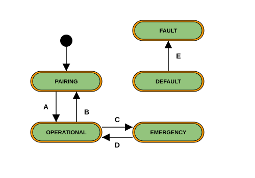

### **State Actions**

| State | Actions |
| :---- | :---- |
| PAIRING | Waiting for Set Estop message from the Safety Client service. Raise INITIALIZING. |
| OPERATIONAL | Check the received Set Estop messages and monitoring health summary of the subsystem. Transition to EMERGENCY when Set Estop is set or the health summary reports error.  |
| EMERGENCY | Obtain control from Subsystem State and set the Subsystem State to Emergency |
| FAULT | Hardware fault. Raise EMERGENCY |

### **Internal Events**

| Event | Parameters | Purpose |
| :---- | :---- | :---- |
| ieReceiveMessage |  |  |

### **Transitions**

| Transition | Trigger | Condition | Action |
| :---- | :---- | :---- | :---- |
| A | Received Set Estop from Safety Client |  | Set the subsystem state to operational and release control from the Subsystem State service |
| B | Set Estop timeout |  | Obtain control from the Subsystem State service and set the subsystem state to emergency. |
| C | Set Estop emergency set or subsystem health summary is error or fatal. |  | Obtain control from the Subsystem State service and set the subsystem state to emergency.  |
| D | Set Estop emergency not set and subsystem health summary is not error or fatal |  | Set the subsystem state to operational and release control from the Subsystem State service. |
| E | Hardware fatal error detected |  | Obtain control from the Subsystem State service and set the subsystem state to emergency |

## **Protocol**

### **Incoming Message Set**

| \# | ID | Message |
| :---- | :---- | :---- |
| 1 | H:0x00000001 L:0x00000143 | Set Estop |
| 2 | H:0x00000001 L:0x00000120 | Report Subsystem Health |
| 3 | H:0x00000001 L:0x00000132 | Confirm Control |
| 4 | H:0x00000001 L:0x00000134 | Report Control |
| 5 | H:0x00000001 L:0x00000142 | Report Subsystem State |
| 6 | H:0x00000001 L:0x00000113 | Report Subsystem Services |

### **Outgoing Message Set**

| \# | ID | Message |
| :---- | :---- | :---- |
| 1 | H:0x00000001 L:0x0000011C | Query Subsystem Health |
| 2 | H:0x00000001 L:0x0000012F | Request Control |
| 3 | H:0x00000001 L:0x00000131 | Query Control |
| 4 | H:0x00000001 L:0x00000140 | Set Subsystem State |
| 5 | H:0x00000001 L:0x00000110 | Query Subsystem Services |

## **Parameters**

1) CYCLEINTERVAL	double, time interval in seconds of each cycle, default=0.02.  
     
2) ESTOPTIMEOUT	double, timeout in seconds for not receiving Set Estop messages before triggering an emergency stop (ESTOP), default=0.3.  
     
3) REPORTDATATIMEOUT	double, timeout in seconds for not receiving updates of control status, subsystem state, or subsystem health, default=2.0.

4) MESSAGEINTERVAL	double, time interval in seconds for sending control and state command messages (Request Control, Query Control, Set Subsystem State), default=0.5.  
     
5) CHECKINTERVAL	double, time interval in seconds for checking e-stop and subsystem health conditions, default=1.0.

6) AUTHORITYCODE	uint8, authority code used by the Safety service when requesting control of SubsystemState, default=225.  
     
7) QUERYSUBSYSTEMSTATEINTERVAL	double, time interval in seconds for sending Query Subsystem State messages to SubsystemState, default=0.5.  
     
8) QUERYSUBSYSTEMHEALTHINTERVAL	double, time interval in seconds for sending Query Subsystem Health messages to StatusMonitor, default=0.5.  
     
9) QUERYSERVICESINTERVAL	double, time interval in seconds for sending Query Subsystem Services messages to the Discovery service, default=5.0.  
     
10) SERVICESREPORTTIMEOUT	double, timeout in seconds for not receiving Report Subsystem Services updates from the Discovery service, default=30.0.

##

# **Resource Discovery** [⬆️](#service-summary "Service Summary")

The service allows components to register their resources and enables clients with Subsystem Access to discover available resources.

Each resource is identified by its URL, which should be directly resolvable without the need for name services. This means the URL must include the IP address of the host, rather than relying solely on a hostname.

In addition to the URL, the registered resource includes the component address of the provider. This component address can be used for configuring and controlling the resource.

Resources are categorized into the following types:

* UNKNOWN  
* VIDEO  
* AUDIO  
* WEB
* MCP
* TELEMETRY
* EXCLUSIVE

Require: Subsystem Access  
Inherit from: none

## **Service Behavior**

### **State Diagram**

### **State Actions**

| State | Actions |
| :---- | :---- |
| READY | Store registered resources Report registered resources |

### **Internal Events**

| Event | Parameters | Purpose |
| :---- | :---- | :---- |
| ieReceiveMessage |  | Indicate a message is received |

### **Transitions**

| Transition | Trigger | Condition | Action |
| :---- | :---- | :---- | :---- |
| A | ieReceiveMessage |  | Process received message |

## **Protocol**

### **Incoming Message Set**

| \# | ID | Message |
| :---- | :---- | :---- |
| 1 | H:0x00000001 L:0x00000147 | Register Resources |
| 2 | H:0x00000001 L:0x00000148 | Query Subsystem Resources |

### **Outgoing Message Set**

| \# | ID | Message |
| :---- | :---- | :---- |
| 1 | H:0x00000001 L:0x00000149 | Report Subsystem Resources |

## **Parameters**

1) CYCLEINTERVAL	double, time interval in seconds of each cycle, default=0.1.  

2) SUBSYSTEMTYPE	string, type of the subsystem reported in Report Subsystem Resources \["UNKNOWN" | "NEURO\_NETWORK" | "WAREHOUSE" | "MANUFACTURING" | "UNMANNED\_VEHICLE" | "SENSOR\_NETWORK" | "CONTROLLER" | "META\_HUMAN"\], default="UNKNOWN".

3) SUBSYSTEMURI	string, URI of this subsystem reported in Report Subsystem Resources, default="asset.ovt.com".

4) DATATIMEOUT	double, timeout in seconds for not receiving updates of registered resources before expiring them, default=30.0.

5) CHECKINTERVAL	double, time interval in seconds for checking registered resources for timeout, default=5.0.

6) EXTERNALIF	string, name of the external ethernet interface used to set up port forwarding for discovered resources, default="".

7) STARTFORWARDPORT	uint16, starting TCP/UDP port number from which forwarded external ports are assigned, default=16000.

##

# **Resource Register** [⬆️](#service-summary "Service Summary")

The Resource Register periodically updates the Resource Discovery service with the component's resources.

Require: none  
Inherit from: none

## **Service Behavior**

### **State Diagram**

### **State Actions**

| State | Actions |
| :---- | :---- |
| READY | Periodically sends Register Resources to the Resource Discovery service. |

### **Internal Events**

| Event | Parameters | Purpose |
| :---- | :---- | :---- |
|  |  |  |

### **Transitions**

| Transition | Trigger | Condition | Action |
| :---- | :---- | :---- | :---- |
| A | ieReceiveMessage |  | Process received message |

## **Protocol**

### **Incoming Message Set**

| \# | ID | Message |
| :---- | :---- | :---- |

### **Outgoing Message Set**

| \# | ID | Message |
| :---- | :---- | :---- |
| 1 | H:0x00000001 L:0x00000147 | Register Resources |

## **Parameters**

1) CYCLEINTERVAL	double, time interval in seconds of each cycle, default=0.1.  
     
2) REGISTERINTERVAL	double, time interval in seconds for periodically sending Register Resources messages to ResourceDiscovery, default=5.0.  
     
3) RESOURCES	List of ResourceRec (ResourceRecList\_t), list of component resources (URI, IP, port, format, description, access right) to register with ResourceDiscovery, default=\[example ResourceRec\].

##

# **Data Topic** [⬆️](#service-summary "Service Summary")

This service provides an interface for clients to publish and subscribe to data topics. To access data topics, clients must have Subsystem Access to the Data Topic service and can only access those for which they have data rights. Clients should periodically send "Subscribe Data Topics" messages to the Data Topic service to maintain their subscriptions.

The Data Topic service also registers data topics with the Data Topic Discovery service, allowing clients to discover available data topics.

Require: Comp Access  
Inherit from: none

## **Service Behavior**

### **State Diagram**

### **State Actions**

| State | Actions |
| :---- | :---- |
| READY | Register data topics to the Topic Discovery Receive data topics |

### **Internal Events**

| Event | Parameters | Purpose |
| :---- | :---- | :---- |
| ieReceiveMessage |  | Indicate a message is received |

### **Transitions**

| Transition | Trigger | Condition | Action |
| :---- | :---- | :---- | :---- |
| A | ieReceiveMessage |  | Process received message |

## **Protocol**

### **Incoming Message Set**

| \# | ID | Message |
| :---- | :---- | :---- |
| 1 | H:0x00000001 L:0x0000014A | Subscribe Data Topics |
| 2 | H:0x00000001 L:0x0000014B | Receive Data Topics |

### **Outgoing Message Set**

| \# | ID | Message |
| :---- | :---- | :---- |
| 1 | H:0x00000001 L:0x0000014C | Register Data Topics |
| 2 | H:0x00000001 L:0x0000014D | Register Schemas |

## **Parameters**

1) CYCLEINTERVAL	double, time interval in seconds of each cycle, default=0.1.  
     
2) REGISTERINTERVAL	double, time interval in seconds for sending Register Data Topics and Register Schemas messages to DataTopicDiscovery, default=5.0.  
     
3) UPDATEINTERVAL	double, time interval in seconds for updating subscription statistics, default=5.0.  
     
4) CHECKSUBSCRIPTIONINTERVAL	double, time interval in seconds for checking whether client topic subscriptions have timed out, default=5.0.  
     
5) SUBSCRIPTIONTIMEOUT	double, timeout in seconds for expiring inactive client topic subscriptions, default=30.0.  
     
6) DATATOPICS	List of DataTopicRec (DataTopicRecList\_t), list of data topics configured on this component to register with DataTopicDiscovery, default=\[example DataTopicRec\].  
     
7) DATATOPICSCHEMAS	List of DataTopicSchemaRec (DataTopicSchemaRecList\_t), list of data topic schemas to register with DataTopicDiscovery, default=\[example DataTopicSchemaRec\].  
     
8) STREAMIF	string, ethernet interface name for the TCP data topic stream server, default="".  
     
9) STREAMIP	string, IP address for the TCP data topic stream server (ignored if STREAMIF resolves to a valid IP), default="192.168.1.2".  
     
10) STREAMPORT	string, TCP listening port for the data topic stream server, default="17000".

## **Set Data**

1) Set data topics to register for publishing  
     
   scheme=data  
   location=datatopiclist  
   type=uli\_sdk::utils::message\_utils::DataTopicRecList\_t  
     
   example: set the data topic to register  
     
   url:  
     
   “data://any/core.DataTopic?location=datatopiclist”  
     
   encoded ptree: DataTopicRecList\_t

2) Publish data in proto format encoded as ptree  
     
   scheme=proto  
   location=\<topic uri\>  
     
   example: publish uli\_kaya.motor\_state in proto format  
     
   url:  
     
   “proto://ayn/core.DataTopic?location=uli\_kaya.motor\_state”  
     
   encoded ptree: protos/ros1.joint\_state

3) Publish data in json format  
     
   scheme=json  
   location=\<topic uri\>  
     
   example: publish uli\_kaya.drive\_cmd in json format  
     
   url:  
     
   “json://any/core.DataTopic?location=uli\_kaya.drive\_cmd”  
     
   encoded topic json string:

## 

	{  
	AcqTime: 12345.67,  
	Schema: “ros1.twist”,  
	Data: {json object}  
	}

##

# **Data Topic Discovery** [⬆️](#service-summary "Service Summary")

The Data Topic Discovery service enables the Data Topic service to register its data topics and allows clients to discover and subscribe to available data topics.

Each registered data topic includes the following information:

* **Name**: The URL of the data topic.  
    
* **Schema**: The URL specifying the schema of the data topic. For example:

  * /com.ovt/uli\_sdk/data\_topics/HealthStatusDetails  
  * /com.ovt/uli\_sdk/data\_topics/VelocityState

* **Data Topic Type**: Specifies how the data topic can be accessed (e.g., Publish, Subscribe, or Event).  
    
* **Data Access Right**: Indicates the required access level for the data topic (e.g., Not Allowed, Unclassified, Controlled, or Classified).

Require: Subsystem Access  
Inherit from: none

## **Service Behavior**

### **State Diagram**

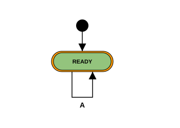

### **State Actions**

| State | Actions |
| :---- | :---- |
| READY | Store registered data topics Report registered data topics |

### **Internal Events**

| Event | Parameters | Purpose |
| :---- | :---- | :---- |
| ieReceiveMessage |  | Indicate a message is received |

### **Transitions**

| Transition | Trigger | Condition | Action |
| :---- | :---- | :---- | :---- |
| A | ieReceiveMessage |  | Process received message |

## **Protocol**

### **Incoming Message Set**

| \# | ID | Message |
| :---- | :---- | :---- |
| 1 | H:0x00000001 L:0x0000014C | Register Data Topics |
| 2 | H:0x00000001 L:0x0000014D | Register Schemas |
| 3 | H:0x00000001 L:0x0000014E | Query Available Data Topics |
| 4 | H:0x00000001 L:0x00000150 | Query Schemas |

### **Outgoing Message Set**

| \# | ID | Message |
| :---- | :---- | :---- |
| 1 | H:0x00000001 L:0x0000014F | Report Available Data Topics |
| 2 | H:0x00000001 L:0x00000151 | Report Schemas |

## **Parameters**

1) CYCLEINTERVAL	double, time interval in seconds of each cycle, default=0.1.  
     
2) DATATIMEOUT	double, timeout in seconds for not receiving updates of registered data topics and schemas before expiring them, default=30.0.  
     
3) CHECKINTERVAL	double, time interval in seconds for checking registered data topics and schemas for timeout, default=5.0.  
     
4) EXTERNALIF	string, name of the external ethernet interface used to set up port forwarding for data topic stream servers, default="".  
     
5) STARTFORWARDPORT	uint16, starting TCP port number from which forwarded ports for data topic stream servers are assigned, default=18000.

##

# **Agent** [⬆️](#service-summary "Service Summary")

The Agent service provides an interface for executing tasks required for a mission. Before making a request, the client queries the Agent to assess its capabilities. Once the request is approved, the client sends control commands to the Agent and receives status reports on its progress. The client can also set a completion timeout. Notifications are sent to the client when the Agent completes the task or if the timeout period is reached.

Require: Comp Control  
Inherit from: Management

## **Service Behavior**

### **State Diagram**

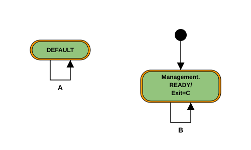

### **State Actions**

| State | Actions |
| :---- | :---- |
| core:Management.READY | Accept request and perform requested actions |
| DEFAULT | Report agent capabilities |

### **Internal Events**

| Event | Parameters | Purpose |
| :---- | :---- | :---- |
| ieReceiveMessage |  | Message received |

### **Transitions**

| Transition | Trigger | Condition | Action |
| :---- | :---- | :---- | :---- |
| A | Query Agent Capabilities, Query Agent Status |  | Process message |
| B | Request Agent, Set Agent Control. |  | Process message |
| C | Management exits READY state |  | Cancel action |

## **Protocol**

### **Incoming Message Set** 

| \# | ID | Message |
| :---- | :---- | :---- |
| 1 | H:0x00000001 L:0x00000152 | Query Agent Capabilities |
| 2 | H:0x00000001 L:0x00000154 | Request Agent |
| 3 | H:0x00000001 L:0x00000156 | Query Agent Status |
| 4 | H:0x00000001 L:0x00000158 | Set Agent Control |

### **Outgoing Message Set**

| \# | ID | Message |
| :---- | :---- | :---- |
| 1 | H:0x00000001 L:0x00000153 | Report Agent Capabilities |
| 2 | H:0x00000001 L:0x00000155 | Confirm Agent |
| 3 | H:0x00000001 L:0x00000157 | Report Agent Status |
| 4 | H:0x00000001 L:0x00000159 | Report Agent Complete |

## **Parameters**

1) CYCLEINTERVAL	double, time interval in seconds of each cycle (inherited from Management), default=0.1.  
     
2) GOTIMEOUT	double, timeout in seconds for not receiving Go messages (inherited from Management), default=2.0.  
     
3) CHECKPAUSEINTERVAL	double, time interval in seconds to check if pause conditions exist (inherited from Management), default=2.0.  
     
4) CONTROLTIMEOUT	double, timeout in seconds for not receiving Set Agent Control messages before stopping the active agent task, default=2.0.  
     
5) STATEWAITTIMEOUT	double, timeout in seconds for waiting in REQUEST\_WAIT, CONTROL\_WAIT, or COMPLETE\_WAIT states before exiting the wait state, default=10.0.  
     
6) FEEDBACKTIMEOUT	double, timeout in seconds for not receiving feedback updates from the downstream controller while performing an action, default=2.0.  
     
7) PERFORMACTIONINTERVAL	double, time interval in seconds for executing the agent's action loop in PERFORM\_ACTION, default=0.2.  
     
8) CHECKSTATEINTERVAL	double, time interval in seconds to check the state and timeouts of the current agent, default=0.5.  
     
9) AGENTREC	AgentRec (AgentRec\_t), agent capability record (name, URI, required access right, control/feedback/complete schemas) reported in Report Agent Capabilities, default=example AgentRec (name="teleop", uri="teleop.apps.uli\_sdk.ovt.com").

## **Data**

Get:

1) location=agentstatus, type=uli\_sdk::services::core:messages::AgentStatusRec\_t

Set:

1) location=agentfeedback, type=uli\_sdk::services::core::messages::AgentFeedbackRec\_t

##

# **Agent Discovery** [⬆️](#service-summary "Service Summary")

This service enables a component to register its agents and allows clients to discover available agents.

Each registered agent includes the component address. This address can be used to access the agent’s capabilities, configurations, status, and required resources.

Require: Comp Access  
Inherit from: none

## **Service Behavior**

### **State Diagram**

### **State Actions**

| State | Actions |
| :---- | :---- |
| READY | Store registered agents Report registered agents |
|       | Query agent status                               |
|       | Report agent abstractions                        |

### **Internal Events**

| Event | Parameters | Purpose |
| :---- | :---- | :---- |
| ieReceiveMessage |  | Indicate a message is received |

### **Transitions**

| Transition | Trigger | Condition | Action |
| :---- | :---- | :---- | :---- |
| A | ieReceiveMessage |  | Process received message |

## **Protocol**

### **Incoming Message Set**

| \# | ID | Message |
| :---- | :---- | :---- |
| 1 | H:0x00000001 L:0x0000015A | Register Agent |
| 2 | H:0x00000001 L:0x00000157 | Report Agent Status |
| 3 | H:0x00000001 L:0x0000015B | Query Agents |

### **Outgoing Message Set**

| \# | ID | Message |
| :---- | :---- | :---- |
| 1 | H:0x00000001 L:0x00000156 | Query Agent Status |
| 2 | H:0x00000001 L:0x0000015C | Report Agents      |

## **Parameters**

1) CYCLEINTERVAL	double, time interval in seconds of each cycle, default=0.1.  
     
2) DATATIMEOUT	double, timeout in seconds for not receiving Register Agent updates before expiring a registered agent, default=30.0.

3) STATUSTIMEOUT	double, timeout in seconds for not receiving Report Agent Status updates from a registered agent, default=3.0.

4) QUERYINTERVAL	double, time interval in seconds for sending Query Agent Status messages to registered agents, default=1.0.

5) CHECKINTERVAL	double, time interval in seconds for checking registered agents and agent statuses for timeout, default=5.0.

##

# **Agent Register** [⬆️](#service-summary "Service Summary")

Agent Register periodically registers agents to the Agent Discovery service.

Require: none  
Inherit from: none

## **Service Behavior**

### **State Diagram**

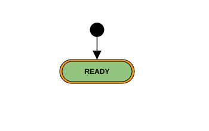

### **State Actions**

| State | Actions |
| :---- | :---- |
| READY | Periodically sends Register Agents to the Agent Discovery service. |

### **Internal Events**

| Event | Parameters | Purpose |
| :---- | :---- | :---- |
|  |  |  |

### **Transitions**

| Transition | Trigger | Condition | Action |
| :---- | :---- | :---- | :---- |
| A | ieReceiveMessage |  | Process received message |

## **Protocol**

### **Incoming Message Set**

| \# | ID | Message |
| :---- | :---- | :---- |

### **Outgoing Message Set**

| \# | ID | Message |
| :---- | :---- | :---- |
| 1 | H:0x00000001 L:0x0000015A | Register Agent |

## **Parameters**

1) CYCLEINTERVAL	double, time interval in seconds of each cycle, default=0.1.  
     
2) REGISTERINTERVAL	double, time interval in seconds for periodically sending Register Agent messages to AgentDiscovery, default=5.0.

3) CONTEXTFILENAME	string, name of the markdown file in the component's working directory containing the context of the agent, default="context.md".

4) PROFILEIMAGEFILENAME	string, name of the JPEG file (".jpg" or ".jpeg") in the component's working directory containing the profile image of the agent, default="profile.jpg".

5) AGENTREC	AgentRec (AgentRec\_t), agent record (name, URI, required app access right, etc.) registered with AgentDiscovery, default=example AgentRec (name="teleop", uri="teleop.apps.uli\_sdk.ovt.com").

##

# **Transform Reporter** [⬆️](#service-summary "Service Summary")

This service allows clients to register transform queries, and the Report Transform messages are sent periodically to these clients.

Additionally, the Transform Reporter registers with the Transform Reporter Discovery service, enabling clients to find and access available transform reporters.

Require: Comp Access  
Inherit from: none

## **Service Behavior**

### **State Diagram**

### **State Actions**

| State | Actions |
| :---- | :---- |
| READY | Response to the Query Transform messages |

### **Internal Events**

| Event | Parameters | Purpose |
| :---- | :---- | :---- |
|  |  |  |

### **Transitions**

| Transition | Trigger | Condition | Action |
| :---- | :---- | :---- | :---- |
| A | ieReceiveMessage |  | Process received message |

## **Protocol**

### **Incoming Message Set**

| \# | ID | Message |
| :---- | :---- | :---- |
| 1 | H:0x00000001 L:0x0000015D | Query Available Transforms |
| 2 | H:0x00000001 L:0x0000015F | Register Transform Query |

### **Outgoing Message Set**

| \# | ID | Message |
| :---- | :---- | :---- |
| 1 | H:0x00000001 L:0x0000015E | Report Available Transforms |
| 2 | H:0x00000001 L:0x00000160 | Report Transform |
| 3 | H:0x00000001 L:0x00000161 | Register Transform Reporter |

## **Parameters**

1) CYCLEINTERVAL	double, time interval in seconds of each cycle, default=0.1.  
     
2) QUERYTIMEOUT	double, timeout in seconds for registered transform queries from clients, default=10.0.  
     
3) DATATIMEOUT	double, timeout in seconds for recorded frame transforms in the transform tree before they are considered stale, default=0.5.  
     
4) REPORTINTERVAL	double, time interval in seconds for computing and sending Report Transform messages to querying clients, default=0.2.  
     
5) REGISTERINTERVAL	double, time interval in seconds for sending Register Transform Reporter messages to TransformReporterDiscovery, default=2.0.  
     
6) REPORTERREC	TransformReporterRec (TransformReporterRec\_t), transform reporter record containing the reporter's description and available transforms to register with TransformReporterDiscovery, default=example TransformReporterRec.

##

# **Transform Reporter Discovery** [⬆️](#service-summary "Service Summary")

This service allows transform reporters to register and enables clients to discover available transform reporters.

Require: none  
Inherit from: none

## **Service Behavior**

### **State Diagram**

### **State Actions**

| State | Actions |
| :---- | :---- |
| READY | Store registered transform reporters Report registered transform reporters |

### **Internal Events**

| Event | Parameters | Purpose |
| :---- | :---- | :---- |
| ieReceiveMessage |  | Indicate a message is received |

### **Transitions**

| Transition | Trigger | Condition | Action |
| :---- | :---- | :---- | :---- |
| A | ieReceiveMessage |  | Process received message |

## **Protocol**

### **Incoming Message Set**

| \# | ID | Message |
| :---- | :---- | :---- |
| 1 | H:0x00000001 L:0x00000161 | Register Transform Reporter |
| 2 | H:0x00000001 L:0x00000162 | Query Transform Reporters |

### **Outgoing Message Set**

| \# | ID | Message |
| :---- | :---- | :---- |
| 1 | H:0x00000001 L:0x00000163 | Report Transform Reporters |

## **Parameters**

1) CYCLEINTERVAL	double, time interval in seconds of each cycle, default=0.1.  
     
2) DATATIMEOUT	double, timeout in seconds for not receiving updates of registered transform reporters before expiring them, default=30.0.

3) CHECKINTERVAL	double, time interval in seconds for checking registered transform reporters for timeout, default=5.0.

##

# **Event Monitor** [⬆️](#service-summary "Service Summary")

The Event Monitor service is in the same component as the Subsystem Manager service. Its role is to receive Event messages from outside of the subsystem and forward the received Event messages to all Event Subscriber services within the subsystem. To discover the Event Subscriber services in the subsystem, it periodically sends Query Subsystem Services messages to the Discovery service and receives Report Subsystem Services messages.

Require: none  
Inherit from: none

## **Service Behavior**

### **State Diagram**

### **State Actions**

| State | Actions |
| :---- | :---- |
| READY | Periodically query subsystem services Receive Event messages from outside of the subsystem and forward them to all Event Subscriber services within the subsystem |

### **Internal Events**

| Event | Parameters | Purpose |
| :---- | :---- | :---- |
| ieReceiveMessage |  | Indicate a message is received |

### **Transitions**

| Transition | Trigger | Condition | Action |
| :---- | :---- | :---- | :---- |
| A | ieReceiveMessage |  | Process received message |

## **Protocol**

### **Incoming Message Set**

| \# | ID | Message |
| :---- | :---- | :---- |
| 1 | H:0x00000001 L:0x00000164 | Event |
| 2 | H:0x00000001 L:0x00000113 | Report Subsystem Services |

### **Outgoing Message Set**

| \# | ID | Message |
| :---- | :---- | :---- |
| 1 | H:0x00000001 L:0x00000164 | Event |
| 2 | H:0x00000001 L:0x00000110 | Query Subsystem Services |

## **Parameters**

1) CYCLEINTERVAL	double, time interval in seconds of each cycle, default=0.1.  
     
2) QUERYSERVICESINTERVAL	double, time interval in seconds for sending Query Subsystem Services messages to the Discovery service to discover EventSubscriber services, default=5.0.

##

# **Event Subscriber** [⬆️](#service-summary "Service Summary")

The Event Subscriber service receives Event messages forwarded by the Event Monitor service within the subsystem.

Require: none  
Inherit from: none

## **Service Behavior**

### **State Diagram**

### **State Actions**

| State | Actions |
| :---- | :---- |
| READY | Receive Event messages forwarded by the Event Monitor service |

### **Internal Events**

| Event | Parameters | Purpose |
| :---- | :---- | :---- |
| ieReceiveMessage |  | Indicate a message is received |

### **Transitions**

| Transition | Trigger | Condition | Action |
| :---- | :---- | :---- | :---- |
| A | ieReceiveMessage |  | Process received message |

## **Protocol**

### **Incoming Message Set**

| \# | ID | Message |
| :---- | :---- | :---- |
| 1 | H:0x00000001 L:0x00000164 | Event |

### **Outgoing Message Set**

| \# | ID | Message |
| :---- | :---- | :---- |

## **Parameters**

1) CYCLEINTERVAL	double, time interval in seconds of each cycle, default=0.1.
