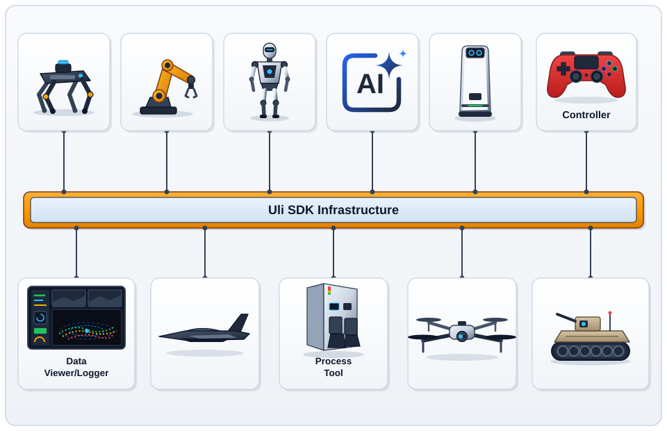
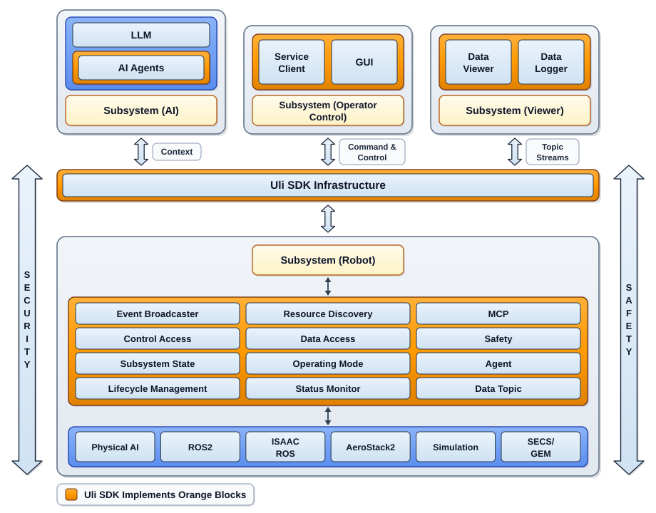
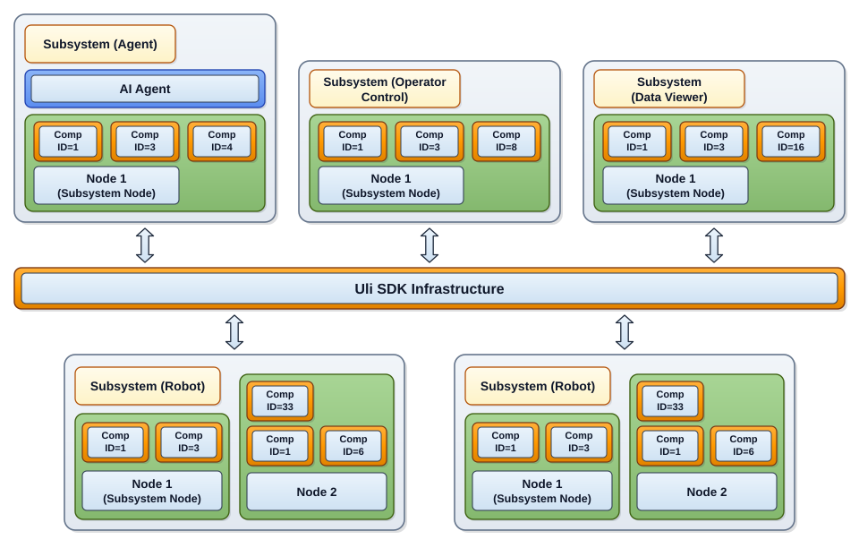
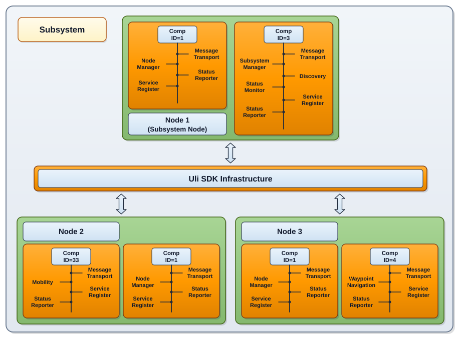
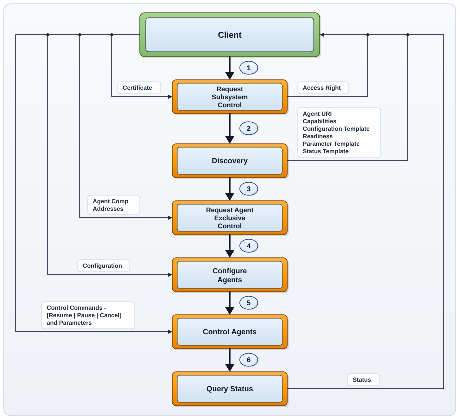
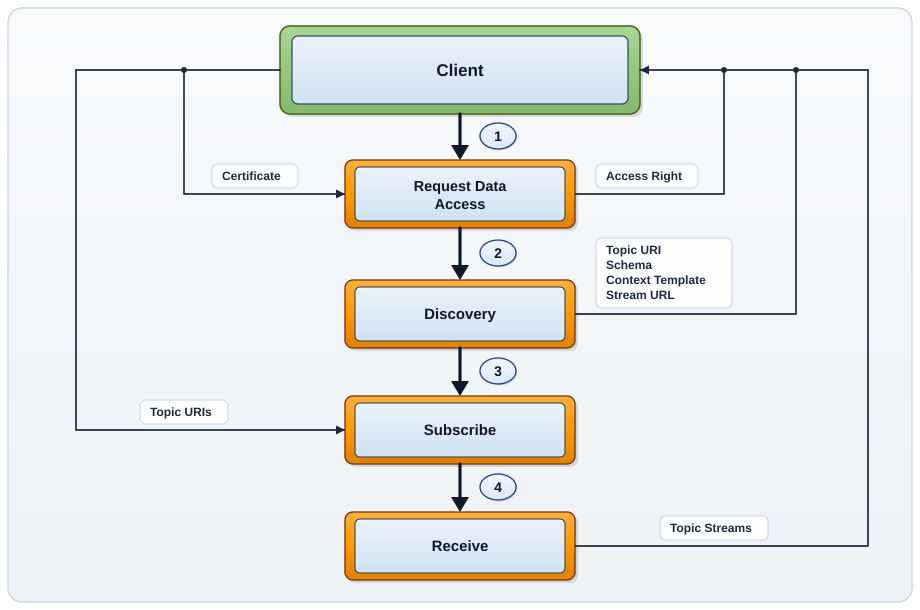

This document is published by Open Vision Technology LLC.

8 Thompson Pond Road, Stoneham, MA 02180, U.S.A.

Tel: 339-293-2151

Copyright 2026 by Open Vision Technology LLC.

This document contains proprietary information protected by copyright. All rights reserved. No part of this document may be photocopied or reproduced without the prior written consent of Open Vision Technology LLC.

##

# **Introduction to Uli SDK**

**Uli (Unified Link Interface) SDK** is a comprehensive set of software libraries for implementing a modular, runtime-adaptive software architecture that connects physical robotic assets, operator control units, data viewers, and modern Agentic AI ecosystems.

By providing production-ready libraries for **infrastructure**, **discovery**, **access governance**, **redundant safety**, and **lifecycle reliability**, Uli SDK eliminates the need to build complex, non-differentiating middleware plumbing from scratch. This empowers engineering teams to focus exclusively on their core, value-adding robotics and AI logic—**shortening the development lifecycle**, **reducing project risk**, **accelerating time-to-market**, and **enabling multi-domain interoperability without vendor lock-in**.

---

## **Core Capabilities & Architectural Pillars**

Uli SDK connects disparate systems—including **drones**, **autonomous ground vehicles**, **robot arms**, **process tools**, **controllers**, **AI agents**, and **data viewers/loggers**—through nine foundational capabilities:

1. **Dynamic, Self-Configuring Infrastructure:** Connects robotic assets at runtime without static IP configuration through automatic identifier allocation and self-learning message routing.
2. **Unified Discovery & AI Knowledge Layer:** Provides unified interfaces to discover robotic assets, their functional capabilities, telemetries, health status, and semantic context—building a live **Knowledge Layer** for AI agents to manipulate assets, access asset resources, and view published data.
3. **Exclusive Asset Control & Handover:** Enforces single-client exclusive control over subsystems and agents to execute missions safely, while supporting authority-based preemption and seamless **control handover** between operators or AI agents.
4. **Shared Data & Telemetry Access:** Enables concurrent, non-exclusive publish-subscribe access to real-time telemetry and data streams published by assets across tiered privilege levels (`Classified`, `Controlled`, `Unclassified`).
5. **Shared Digital Resource Access:** Provides unified discovery and shared access to digital resources published by assets, including **audio**, **video**, **web** endpoints, and **MCP (Model Context Protocol)** servers.
6. **CoT-Style Event Broadcasting:** Broadcasts system-wide situational events structured around the Cursor-on-Target (CoT) model—**When**, **Where**, and **What**—with support for embedding **images** and **3D/AI models** directly within events.
7. **Redundant Safety Management:** Protects operational integrity through redundant health monitoring and multi-path emergency (**E-Stop**) propagation that immediately transitions safety-critical applications into a safe state.
8. **Highly Modular & MOSA Compliant:** Adheres to the Department of Defense (DoD) **Modular Open Systems Approach (MOSA)**, encapsulating functionality into swappable components and services with standardized interfaces.
9. **Easy Integration with ROS & AI Agents:** Automatically generates **Python** and **Dart-FFI** bindings for out-of-the-box integration with **ROS / ROS 2**, **Physical AI**, **LLM / ReAct Agents**, **MCP**, **Simulations**, and **Flutter A2UI** interfaces.

---

## **Infrastructure**

The Uli SDK infrastructure organizes computing resources into a three-tier hierarchy:

* **Subsystem:** A logical grouping of one or more nodes representing a complete robotic asset, operator station, or AI system.
* **Node:** A physical or virtual computing device within a subsystem.
* **Component:** An application hosted on a node that groups related **Services**.

### **Dynamic Addressing & Routing**

Every entity is addressed using a unique tuple `(Subsystem ID, Node ID, Comp ID)`:

* **Dynamic ID Allocation:** Analogous to DHCP, the SDK's **Id Allocator** service assigns unique IDs to subsystems at runtime, and each subsystem's **Subsystem Manager** allocates unique IDs to its internal nodes.
* **High-Performance Transport:** Messages are serialized with **Cap'n Proto** and transmitted via local sockets, UDP unicast, or UDP multicast. Logical network **partitions** isolate traffic so only services within the same partition communicate.
* **Zero-Config Routing:** A **Node Manager** service on each node dynamically learns routes from processed traffic and forwards messages based solely on Uli identifiers, abstracting away underlying IP addresses and network topologies.

---

## **Services**

A **Service** is the fundamental building block of functionality in the Uli SDK. Each service is formally defined by its input/output messages, internal events, governing state machine, and configurable parameters. Related services are packaged together into a **Component**.

To guarantee system-wide discoverability and observability, every component implements two mandatory services:

* **Service Register:** Enables dynamic runtime discovery so other services can locate and interact with the component automatically.
* **Status Reporter:** Provides a standardized interface for reporting the component's operational state, health status, and context.

Beyond internal infrastructure services, Uli SDK elevates **Agents**, **Data Topics**, **Digital Resources**, and **Events** as the primary interfaces for interacting with connected assets.

---

## **Agents & Exclusive Control**

**Agents** represent the active, commandable capabilities of a robotic asset. Through the **Agent Discovery** and **Subsystem Control** services, clients dynamically discover an agent's capabilities, readiness, parameter schemas, and status templates, and acquire **exclusive control** to execute missions.

* **Exclusive Control & Handover:** Only one authorized client (`Operator`, `Maintainer`, or `Administrator`) can command a subsystem and its agents at any time. Control can be seamlessly **handed over** between clients or preempted by a higher-authority operator.
* **AI Tool Grounding:** For LLM and Agentic AI frameworks, Uli SDK agents serve as discoverable, self-describing **tools** complete with capability context, configuration templates, control parameters, and real-time execution feedback.

**Unified Agent Control Workflow:**

1. Request exclusive control of the subsystem (authenticated via client certificate).
2. Discover authorized agents, their capabilities, readiness, and parameter/configuration templates.
3. Request exclusive control of the target agent.
4. Configure the agent for the mission.
5. Command the agent (`Resume` / `Run`, `Pause`, `Cancel`) and update runtime parameters.
6. Query and monitor real-time agent status (or hand over control when complete).

---

## **Data Topics, Digital Resources & CoT Events**

### **Shared Data Topics & Telemetry**

**Data Topics** disseminate real-time telemetry and sensor streams using a non-exclusive publish-subscribe model. Publishers register topics with the **Data Topic Discovery** service, allowing authorized clients (`Classified`, `Controlled`, `Unclassified`) to discover topic schemas, telemetry context, and stream URLs on the fly.

**Unified Data Topic Workflow:**

1. Request shared (non-exclusive) data access to the subsystem.
2. Discover authorized data topics, schemas, context templates, and stream URLs.
3. Subscribe to data topics of interest.
4. Receive real-time data topic streams.

### **Shared Digital Resources**

Assets can publish and expose rich digital resources via the **Resource Discovery** service. Authorized clients and AI agents can dynamically discover and share access to:

* **Audio & Video Streams** for live operator situational awareness and multimodal AI perception.
* **Web Endpoints** for asset dashboards, documentation, and REST/HTTP interfaces.
* **MCP (Model Context Protocol) Servers** for direct tool and context integration with LLM agents.

### **CoT-Style Event Broadcasting**

The **Event Broadcaster** service enables assets and clients to broadcast asynchronous, system-wide events structured in the **Cursor-on-Target (CoT)** paradigm:

* **When:** Precise event timestamps and validity intervals.
* **Where:** Geodetic or local coordinate frame location of the event.
* **What:** Structured event type, severity, and semantic description.
* **Embedded Media & Models:** Events can embed **images** (e.g., target snapshots, anomaly captures) and **3D/AI models** to provide immediate visual and spatial context to operators and AI agents.

---

## **AI Knowledge Layer & A2UI Framework**

### **Contextual Knowledge Graph**

Through its unified discovery services, Uli SDK exports semantically rich Markdown context covering **asset identity**, **capabilities**, **telemetries**, **digital resources**, and **health status**. This discovered context forms a live **Knowledge Graph-driven Context Layer** that powers the AI cognitive cycle:

* **Reasoning:** AI agents query the knowledge layer to select assets with the required capabilities, health status, data privileges, and control availability.
* **Execution:** Agents retrieve exact capability and parameter schemas from the graph to generate valid configurations and mission commands.
* **State Estimation:** Agents combine telemetry context with live data streams and CoT events to maintain an accurate world model of fleet status and environment state.

### **A2UI (Agent-to-UI) Framework**

Using native **Dart-FFI** bindings, Uli SDK bridges its C++ core directly with **Flutter**. Embedded context metadata identifies the appropriate **Flutter UI Widgets** for rendering live video, 3D point clouds, occupancy grids, and interactive agent configuration controls—allowing AI agents to dynamically drive the operator user interface (**A2UI**).

---

## **Security, Safety & Reliability**

* **Zero-Trust Security:** Enforces certificate-based authentication with strict separation between **Data Access** (shared, tiered: `Classified`, `Controlled`, `Unclassified`) and **Control Access** (exclusive, tiered: `Operator`, `Maintainer`, `Administrator`). Distinct, time-limited session UUIDs govern data subscriptions and agent commands.
* **Redundant Safety:** Protects assets through multi-path fault detection and emergency propagation. Critical application faults (reported via `Status Reporter` / `Health Monitor`) or manual operator **E-Stop** triggers propagate across redundant paths (`Safety Client`, `Safety`, and `Subsystem State Client`) to immediately transition all safety-critical modules into a predefined **EMERGENCY** state.
* **Two-Tiered Reliability:** A top-level **Subsystem State** machine (`INITIALIZE`, `OPERATIONAL`, `PAUSE`, `EMERGENCY`, `SHUTDOWN`, `RENDER USELESS`) orchestrates individual module **Lifecycle Management** state machines, complemented by granular **Operating Modes** (`Standard`, `Reduced`, `Training`, `Maintenance`).

---

## **Integration, Development & Tools**

### **ROS & AI Ecosystem Integration**

Uli SDK automatically generates **Python** and **Dart-FFI** bindings, enabling rapid integration with **ROS / ROS 2**, **NVIDIA Isaac ROS**, **AeroStack2**, **Physical AI**, **Simulations**, **ReAct / MCP Agents**, and **Flutter** applications.

### **Supported Platforms**

| OS | Target Device | Development Host (`x86_64`) |
| :--- | :--- | :--- |
| **JetPack 7.2** | NVIDIA Jetson Orin Nano/NX, Thor, DGX | Ubuntu 24.04 |
| **JetPack 6.2** | NVIDIA Jetson Orin Nano/NX, AGX | Ubuntu 22.04 |
| **Ubuntu 22.04 – 24.04** | `x86_64` | Ubuntu 22.04 – 24.04 |

### **Build & Code Generation Tools**

* **Automated Code Generation:** Generates concise C++ code for records, Cap'n Proto messages, state-machine services, and component applications, alongside Python and Dart-FFI bindings.
* **Cross-Platform Bazel Build System:** Uses **Bazel** for fast, reproducible builds and seamless cross-compilation across `x86_64` and `ARM64` architectures, paired with staging and multi-device deployment scripts.
* **AI-Assisted Development:** Built-in project skills and context allow **Google Antigravity IDE** and **Claude CLI** to assist with service generation, and application development.

Visit our website: [www.ulisdk.com](http://www.ulisdk.com)
