This document is published by Open Vision Technology LLC.

8 Thompson Pond Road, Stoneham, MA 02180, U.S.A.

Tel: 339-293-2151

Copyright 2026 by Open Vision Technology LLC.

This document contains proprietary information protected by copyright. All rights reserved. No part of this document may be photocopied or reproduced without the prior written consent of Open Vision Technology LLC.

##

# **Function Summary**

| Name |
| :---- |
| [Dynamic ID Allocation](#dynamic-id-allocation)|
| [Subsystem Manager](#subsystem-manager)|
| [Dynamic Node ID Assignment](#dynamic-node-id-assignment)|
| [Node Manager](#node-manager)|
| [Link Report](#link-report)|
| [Service Registration](#service-registration)|
| [Service Discovery](#service-discovery)|
| [Status Monitor](#status-monitor)|
| [Subsystem Access](#subsystem-access)|
| [Subsystem Control](#subsystem-control)|
| [Subsystem Control Handover](#subsystem-control-handover)|
| [Comp Access](#comp-access)|
| [Comp Control](#comp-control)|
| [Life Cycle Management](#life-cycle-management)|
| [Initialize](#initialize)|
| [Operational](#operational)|
| [Emergency](#emergency)|
| [Pause](#pause)|
| [Safety](#safety)|
| [Operating Mode](#operating-mode)|
| [Resource Registration](#resource-registration)|
| [Resource Discovery](#resource-discovery)|
| [Data Topic Discovery](#data-topic-discovery)|
| [Data Topic Subscription](#data-topic-subscription)|
| [Agent Discovery](#agent-discovery)|
| [Agent](#agent)|
| [Transform Reporter Discovery](#transform-reporter-discovery)|
| [Transform Reporter](#transform-reporter)|

##

# **Dynamic ID Allocation** [⬆️](#function-summary "Function Summary")

Without knowing its ID, the **Subsystem** **Manager** periodically broadcasts **ID** **Request** messages in the hope that the **ID** **Allocator** service, somewhere in the network, will respond with **ID** **Granted** messages. Once the **Subsystem** **Manager** obtains its ID, it broadcasts a **Subsystem** **Manager** **Ready** message to the **Node** **Managers**, inviting them to join the subsystem. For more details, refer to Subsystem Manager Message Interaction.  

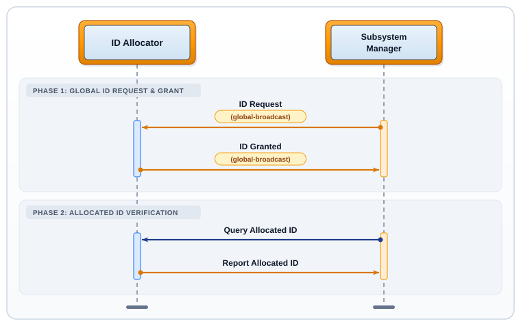

##

# **Subsystem Manager** [⬆️](#function-summary "Function Summary")

The **Subsystem** **Manager** service manages a logical group of related computing devices (nodes). Once the ID is assigned, the **Subsystem** **Manager** service broadcasts **Subsystem** **Manager** **Ready** messages to invite the nodes to join the subsystem. For more details, refer to Dynamic ID Allocation Message Interaction.  

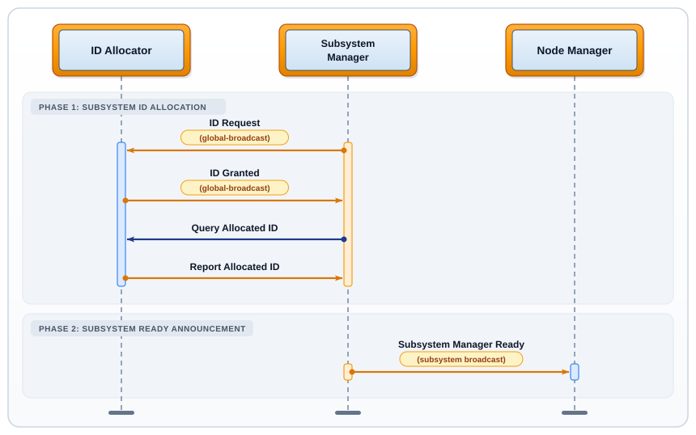

##

# **Dynamic Node ID Assignment** [⬆️](#function-summary "Function Summary")

Dynamic Node ID Assignment allows the **Subsystem** **Manager** to assign an ID to the **Node** **Manager**, enabling a **Node** **Manager** without a pre-defined ID to join the subsystem.

The **Node** **Manager** waits for a **Subsystem** **Manager** **Ready** message from the **Subsystem** **Manager**. Upon receiving this message, the **Node** **Manager** sends a **Node** **ID** **Request** to the **Subsystem** **Manager**. The **Subsystem** **Manager** then assigns a Node ID and responds with a **Node** **ID** **Allocated** message.

Once the **Node** **Manager** receives the assigned ID, it broadcasts a **Node** **Manager** **Ready** message to all components within the node. This process resolves the addresses of the components, which then sends **Component** **Ready** messages back to the **Node** **Manager**. For further details, see Node Manager Message Interaction.

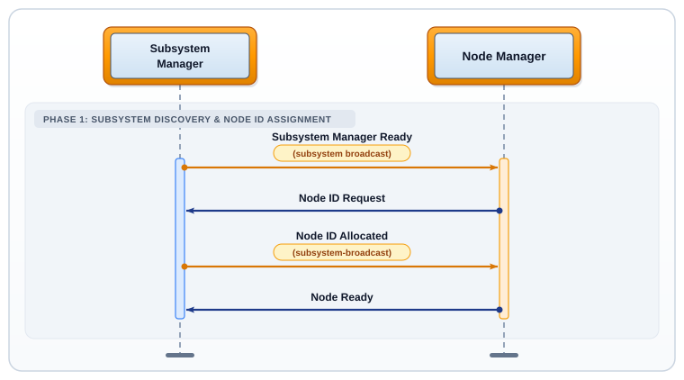  

##

# **Node Manager** [⬆️](#function-summary "Function Summary")

The **Node Manager** is responsible for managing and routing messages for the components within a node (computing device). Once the Node Manager’s ID is assigned, it periodically broadcasts **Node Manager Ready** messages to all components in the node. In response, the components send **Component Ready** messages back to the Node Manager. This process validates the addresses of the components and establishes communication between them within the network.

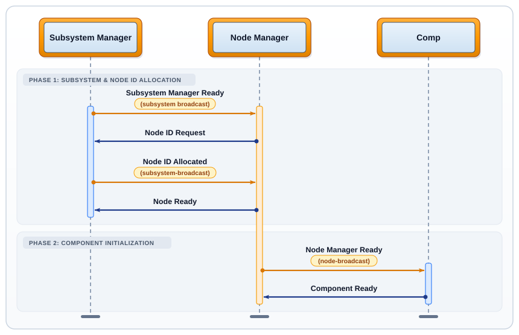  

##

# **Link Report** [⬆️](#function-summary "Function Summary")

The **Link Report** provides the round-trip time for messages between source and destination components. Each component periodically performs a **Link Test** by sending a **Query Link** message to known destination components. The destination component responds with a **Report Link** message, which is used to calculate the round-trip time. This Link Test is conducted over a predefined interval.

The round-trip time information is included in the component's status details, which are registered with the **Status Monitor** service.  

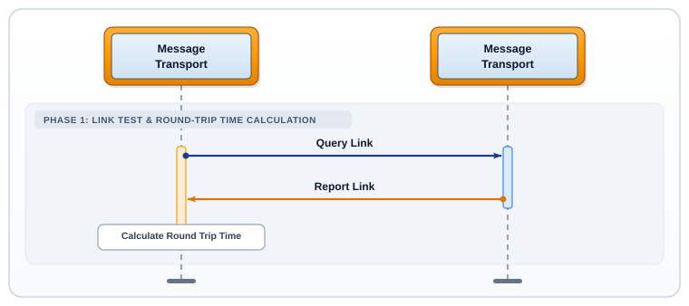

##

# **Service Registration** [⬆️](#function-summary "Function Summary")

Upon receiving the **Node Manager Ready** message, the component registers its services with the **Discovery** service. The registration includes the service's URL, as well as its major and minor versions.

The **Discovery** service, which resides within the **Subsystem Manager** component, is responsible for collecting and managing the registered services from all components in the subsystem.  

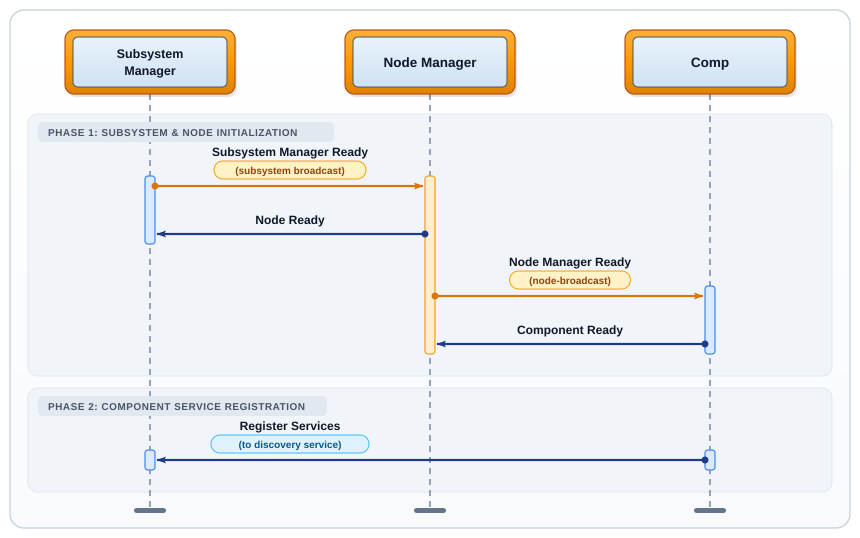

##

# **Service Discovery** [⬆️](#function-summary "Function Summary")

The **Service** **Discovery** process identifies which component implements a given service.

The Operator Control (the client) initiates the process by broadcasting **Query Identification** messages. The Discovery service that receives the query responds with a **Report Identification** message, which includes the address of the Subsystem Manager component where the Discovery service is located.

The Operator Control (the client) then sends a **Query Comp Services List** request to the Discovery service. The Discovery service replies with a **Report Comp Services List** message, providing the addresses of the components where the requested services are implemented.  
						  
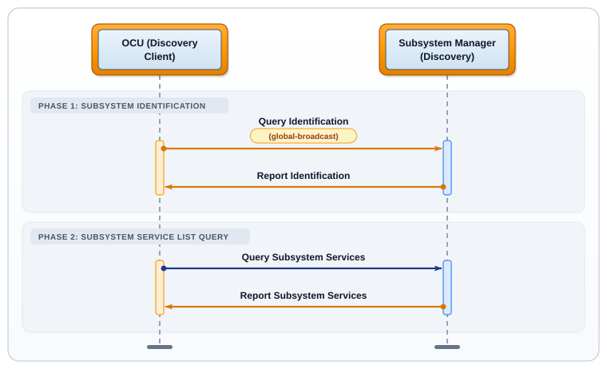 

##

# **Status Monitor** [⬆️](#function-summary "Function Summary")

The status details of each service within the component are continuously updated and registered with the **Status Monitor** service by the component’s **Status Register** service. The Status Monitor manages this registered status information and reports it to the **Operator Control** (client).

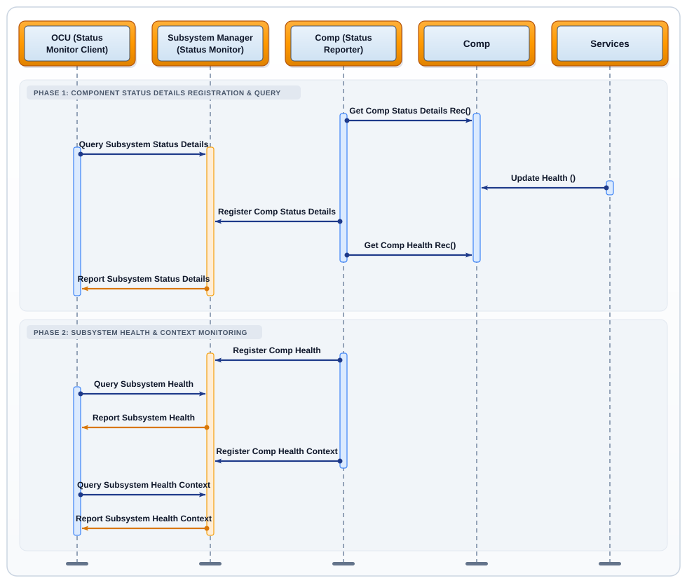

##

# **Subsystem Access** [⬆️](#function-summary "Function Summary")

Clients need both **App Access Rights** and **Data Access Rights** to access application data and data topics within a subsystem. The **Subsystem Access** service provides the interface through which clients can obtain these rights.

Clients periodically send **Request Subsystem Access** messages. The Subsystem Access service determines the App Access Rights and Data Access Rights based on the client’s certificate included in the request. These rights, along with a **Session UUID**, are then returned in **Confirm Subsystem Access** messages.

* **App Access Right**: Necessary for accessing app data, which includes Status Details, Service List, Resource List, Data Topic List, and Agent List. Clients retrieve app data using the Get Data function.  
    
* **Data Access Right**: Required for subscribing to data topics. Clients can only receive data topics for which they have the appropriate entitlement.

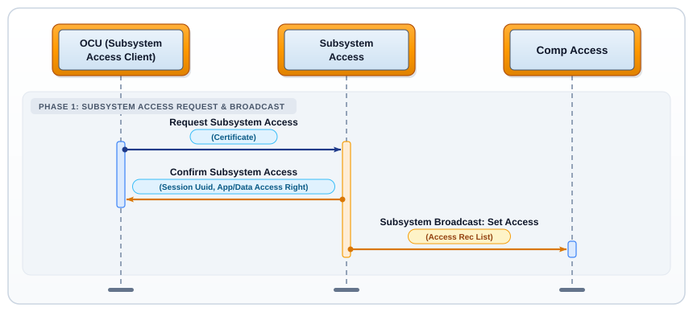

##

# **Subsystem Control** [⬆️](#function-summary "Function Summary")

**Subsystem Control** allows a client to gain exclusive control over components (comps) within the subsystem, enabling the client to utilize their services.

The **Operator Control** (client) sends a **Request Subsystem Control** message, including its authority code and certificate. If control is granted, the **Subsystem Control** service responds with a **Confirm Subsystem Control** message that includes a response code of "Granted" and a **Session UUID**.

The Subsystem Control service then distributes the **Session UUID** to all **Comp Control** services within the subsystem. The Operator Control (client) must provide the correct **Session** **UUID** to access any of the services.

When no client is in control, the **Subsystem** **Control** service broadcasts a default **Session** **UUID** to all **Comp** **Control** services in the subsystem.				  

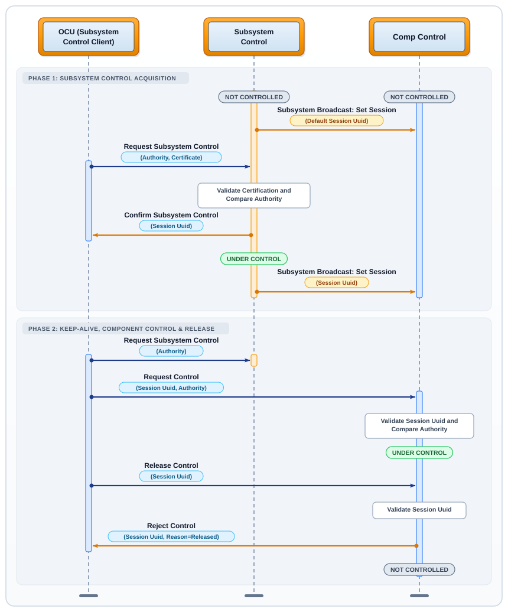

##

# **Subsystem Control Handover** [⬆️](#function-summary "Function Summary")

If another **Operator Control** (client) needs to access the subsystem, the **Subsystem Control** service facilitates control handover by requesting the currently controlling **Operator** **Control** (client) to release control. The following illustrates the message interactions between two **Operator** **Controls** (clients) and the **Subsystem** **Control** service during the control handover process.

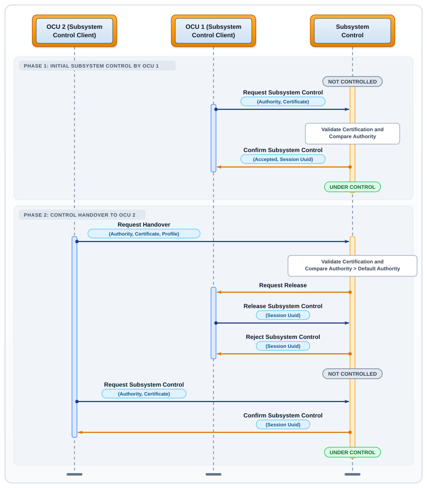

##

# **Comp Access** [⬆️](#function-summary "Function Summary")

The **Comp Access** service receives an access record list from **Set Access** messages sent by the **Subsystem Access** service. Each access record includes the client's Subsystem ID, Session UUID, **App Access Right**, and **Data Access Right**.

When requesting application data or subscribing to data topics, the client must include the **Session ID** in both the **Get Data** function calls and **Subscribe Data Topic** messages. The **App Data** provider component and the **Data Topic** service verify the Session ID before processing the data request or subscription.

(See **Subsystem Access** and **Data Topic Subscription** for further details.)

##

# **Comp Control** [⬆️](#function-summary "Function Summary")

The **Comp Control** service enforces exclusive access to its services, ensuring that only command messages from the authorized client are executed.

Before sending a **Request Control** message to the Comp Control service, the **Operator Control** (client) must first obtain the **Session UUID** from the **Subsystem Control** service. The Comp Control service then validates the Session UUID and compares the Authority Code. Access is granted if the Session UUID matches and the Authority Code is higher than the current one.

The Subsystem Control service continuously updates the Comp Control service with the current Session UUID by periodically sending **Set Session UUID** messages. If this message is not received within the expected timeframe, the Comp Control service will reject any control requests.  
				
##

# **Life Cycle Management** [⬆️](#function-summary "Function Summary")

**Life Cycle Management** is implemented at two levels: the Subsystem level and the Component level. The **Subsystem State** service manages the life cycle at the Subsystem level, while the **Management** service handles life cycle management at the Component level. Together, these services ensure comprehensive management of the entire life cycle process.

The **Subsystem State** service sends command messages—**Reset**, **Set Emergency**, **Clear Emergency**, **Pause**, **Resume**, **Shutdown**, and **Render Useless**—to all **Management** services within the subsystem. The Management services then transition to the appropriate states in response to these commands.

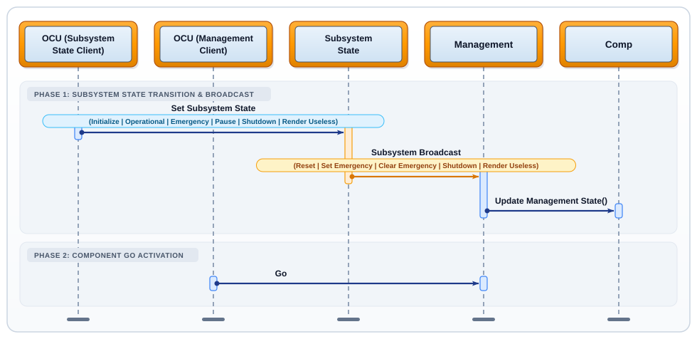

The **Subsystem State** service monitor the Management States of all Management services in the subsystem. It retrieves the states of the **Management** services from the **Status Monitor** service.

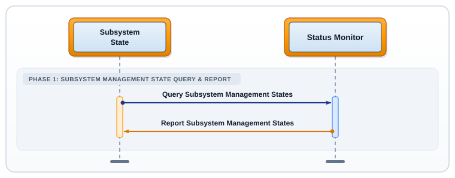

## **Initialize** [⬆️](#function-summary "Function Summary")

The **Subsystem State** service begins in the **INITIALIZING** state, during which it sends **Reset** messages to all **Management** services. Once it confirms that all Management services have transitioned to the **INITIALIZE** state, the Subsystem State service moves to the **INITIALIZE** state and sends **Start** messages to the Management services. The Management services then proceed with their initialization processes and transition to the **STAND\_BY** state once initialization is complete.

After confirming that all **Management** services are in either the **STAND\_BY** or **READY** state, the **Subsystem State** service transitions to the **OPERATIONAL** state.

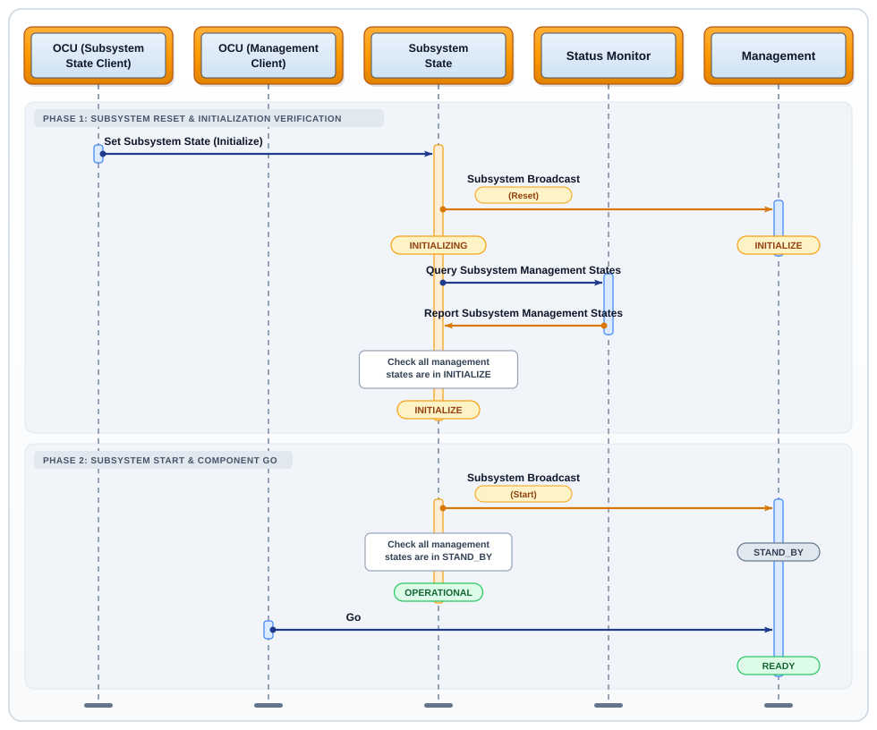

## **Operational** [⬆️](#function-summary "Function Summary")

Once initialization is complete, the **Management** services transition to the **STAND\_BY** state. To transition to the **READY** state, **Operator Control** must send **GO** messages. Client command messages can only be executed when the Management services are in the **READY** state.  

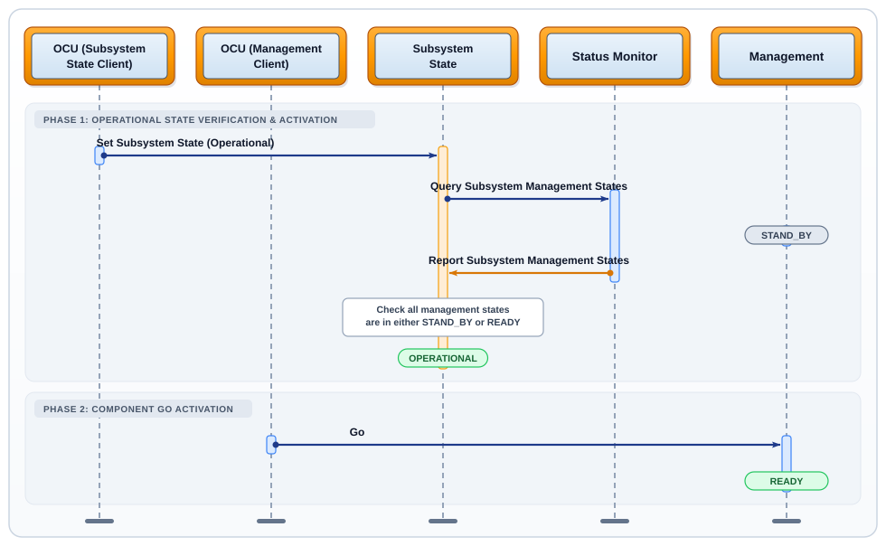  

## **Emergency** [⬆️](#function-summary "Function Summary")

When an emergency stop (e-stop) is triggered, the **Safety** service takes control of the **Subsystem State** service and sends **Set Subsystem State (EMERGENCY)** messages. This causes the Subsystem State service to transition to the **EMERGENCY** state and send **Set Emergency** messages to all **Management** services.

When the e-stop is released, the Safety service sends **Set Subsystem State (OPERATIONAL)** messages to the Subsystem State service. The Subsystem State service then transitions back to the **OPERATIONAL** state and sends **Clear Emergency** messages to the Management services.

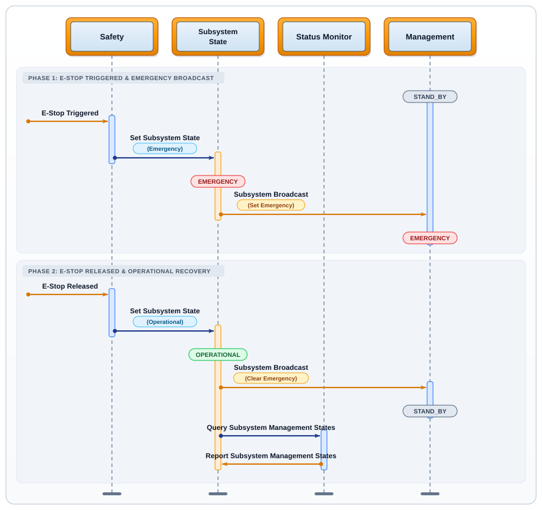

## **Pause** [⬆️](#function-summary "Function Summary")

The **Management** service periodically checks for pause conditions. If such conditions are detected, the Management service transitions to the **PAUSE** state.

The **Subsystem State** service monitors the Management services and, upon detecting that one of them has entered the PAUSE state, it also transitions to the **PAUSE** state. It then broadcasts **PAUSE** messages, prompting all Management services within the subsystem to transition to the PAUSE state.

While in the PAUSE state, if a Management service no longer detects pause conditions, it transitions to the **CONTINUE** state and waits for **RESUME** messages from the Subsystem State service to move to the **STAND\_BY** state.

The Subsystem State service will return to the **OPERATIONAL** state once it confirms that none of the Management services are in either the PAUSE or CONTINUE state.  

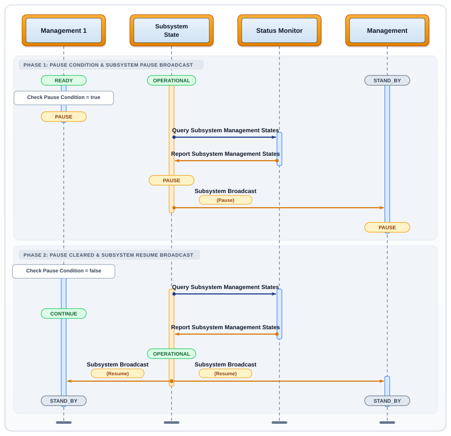  

## **Notes**

1. Services that perform safety-critical operations should be derived from the **Management** service.  
     
2. The component hosting the Management-derived service must also host the **Comp Control** service.

3. Command messages sent to Management-derived services are only processed when the Management service is in the **READY** state. It is the client’s responsibility to send a **GO** message to transition the Management service to the **READY** state.  
     
4. **Comp Control** for the component is unavailable when the Management service is in the **EMERGENCY** state.

##

# **Safety** [⬆️](#function-summary "Function Summary")

The **Safety** service periodically receives **Set Estop** messages from the Safety client, which indicate the state of the emergency stop (e-stop) condition, such as whether the e-stop button has been pressed. When a **Set Estop** message indicates an e-stop condition, the Safety service triggers the **EMERGENCY** state.

Additionally, the Safety service regularly queries the **Health Summary** from the **Status Monitor** service. If the Health Summary reports an **Error** or **Fatal** status, the Safety service also triggers the **EMERGENCY** state.  
								  
For redundancy, the Safety client also queries the Health Summary from the subsystem’s Status Monitor service. If the Health Summary indicates an **Error** or **Fatal** condition, the Safety client sends a **Set Estop** message.

To trigger the **EMERGENCY** state, the Safety service takes control and sets the **Subsystem State** service to **EMERGENCY**, causing all **Management** services to enter the EMERGENCY state and halt command processing.

Once the EMERGENCY condition is resolved, the Safety service sets the Subsystem State back to **OPERATIONAL** and relinquishes control of the Subsystem State service.

The component hosting the Safety service must also host the **Comp Control** service. The Safety client needs to obtain control of the component before sending **Set Estop** messages.  

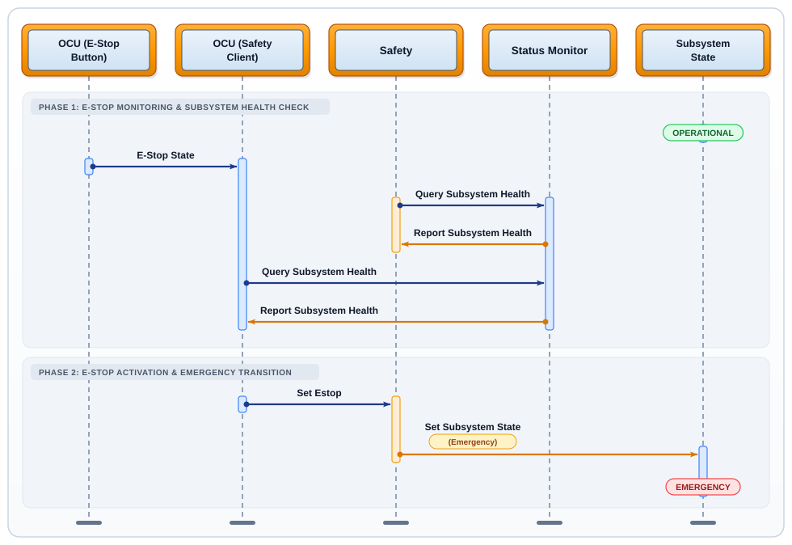  

The following two diagrams show the interactions between Subsystem Control, Subsystem State and Safety, and their clients:  

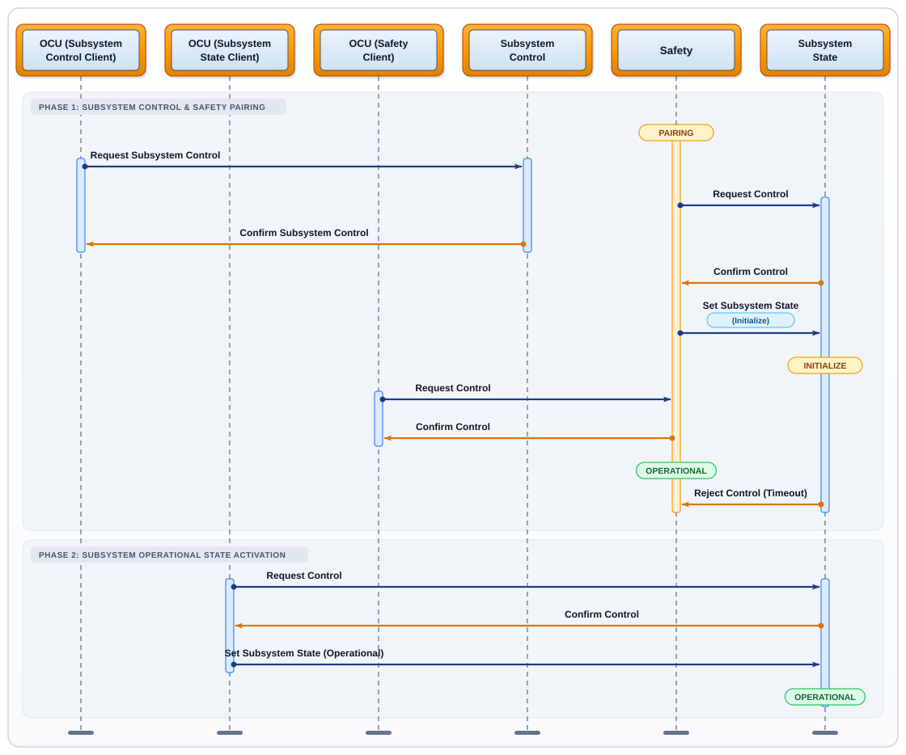 

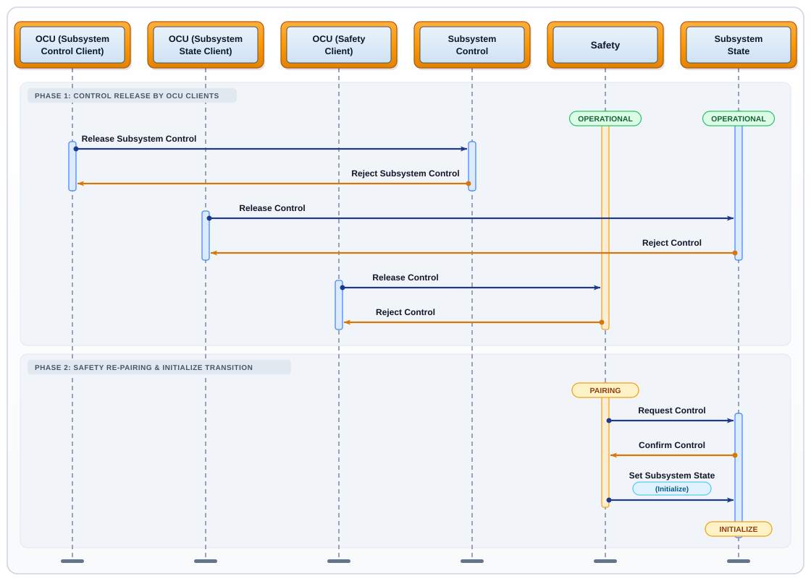

##

# **Operating Mode** [⬆️](#function-summary "Function Summary")

The **Operating Mode** determines how services execute commands. Once the Operator Control gains control of the subsystem, it broadcasts **Set Operating Mode** messages. Components that implement Operating Mode services adjust their modes accordingly. It’s important to note that the Operator Control (client) must have **Comp Control** over the components before setting the Operating Mode.

The Operating Mode can be set to **Standard Operating**, **Training**, or **Maintenance**, and services will execute commands based on the current mode.

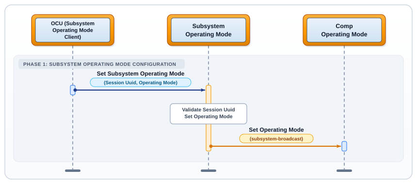  

##

# **Resource Registration** [⬆️](#function-summary "Function Summary")

After receiving **Node Manager Ready** messages, the component registers its resources with the **Resource Discovery** service.

The **Resource Discovery** service collects and manages registered resources from all components within the subsystem. If resources are provided by components on a different subnet than the **Subsystem Manager**, the Resource Discovery service handles port forwarding, allowing clients to access these resources from the subnet where the Subsystem Manager is located.  

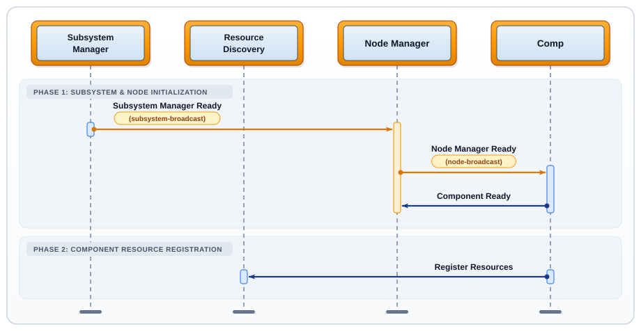

##

# **Resource Discovery** [⬆️](#function-summary "Function Summary")

**Resource Discovery** is responsible for locating components that provide resources.

Similar to the **Discovery** service, the **Resource Discovery** service is part of the **Subsystem Manager** component. The Operator Control (client) initiates a search for subsystems by broadcasting a **Query Identification** message. The Subsystem Manager responds with a **Report Identification** message, which includes the address of the Subsystem Manager.

The Operator Control then sends a **Query Resources** message to the Subsystem Manager, which replies with a **Report Resources** message containing the information of the registered resources.  

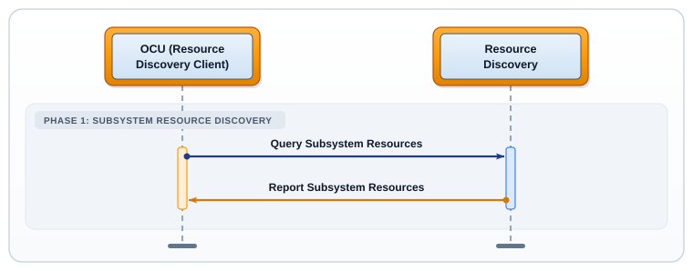

##

# **Data Topic Discovery** [⬆️](#function-summary "Function Summary")

The **Data Topic** service registers available data topics with the **Data Topic Discovery** service. Each registered data topic is identified by a name URL and schema URL, and the registration specifies the required **Data Access Rights** for accessing the topic.

Clients can query available data topics through the **Data Topic Discovery** service and subscribe to the desired topics via the **Data Topic** service.

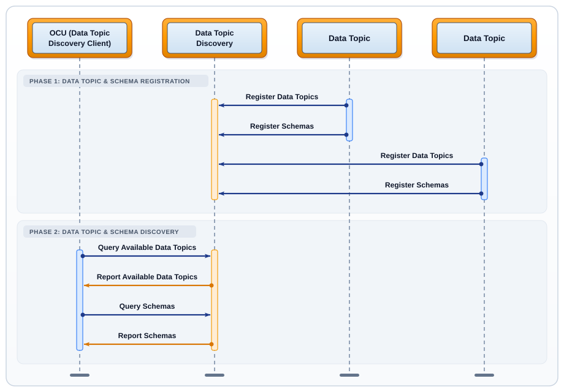

##

# **Data Topic Subscription** [⬆️](#function-summary "Function Summary")

Before subscribing to Data Topics, the client must first obtain Subsystem Access. Once Subsystem Access is confirmed, the client can subscribe to the Data Topics using the Session UUID provided in the *Confirm Subsystem Access* messages.

For security reasons, the Session UUID changes periodically. The client must use the most recent Session UUID provided in the latest *Confirm Subsystem Access* message to ensure proper access

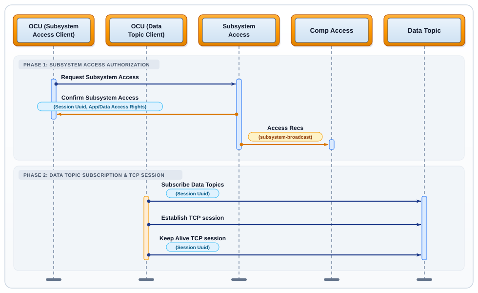

##

# **Agent Discovery** [⬆️](#function-summary "Function Summary")

Agents within a subsystem are registered with the **Agent Discovery** service, enabling clients to locate available agents. Once identified, clients can query agents for details about their capabilities, configurations, status, and resource requirements.

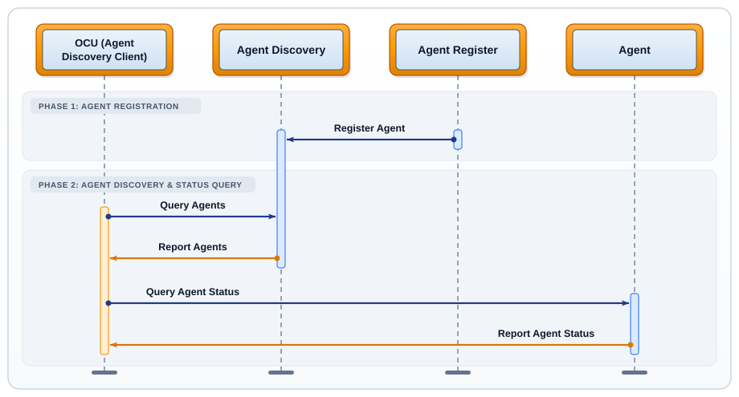

##

# **Agent** [⬆️](#function-summary "Function Summary")

An **Agent** is responsible for carrying out tasks required for a task. Since the Agent inherits functionality from the Management service, clients must have Comp Control and send **GO** messages to transition the Agent service to the **READY** state (see the Life Cycle Management section above).

To execute the task, the Operator Control Unit (OCU) first queries the Agent's capabilities then sends the RUN request. Once the request is granted, the OCU periodically sends **Set Agent Control** messages to manage the progress. After completion, or in the event of a timeout, the Agent sends a **Report Agent Complete** message to the OCU. The OCU can monitor the progress by sending **Query Agent Status** messages.

Agents are registered with the **Agent Registrar** service, making them discoverable through the **Agent Discovery** service.

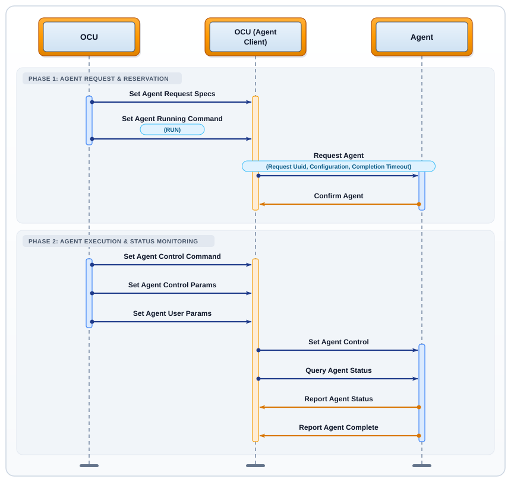  

##

# **Transform Reporter Discovery** [⬆️](#function-summary "Function Summary")

**Transform Reporter Discovery** enables clients to locate available Transform Reporters within a Subsystem. Once located, clients can register Transform Queries with these Transform Reporters to receive transform reports.

Conversely, Transform Reporters must first register themselves with the Transform Reporter Discovery service to be discoverable by clients.

##

# **Transform Reporter** [⬆️](#function-summary "Function Summary")

A **Transform Reporter** provides transformation data between coordinate frames in parent-child pairs. Clients register transform queries, specifying the parent-child pairs for which they need transformation data. The Transform Reporter then delivers the relevant transforms for each registered query.

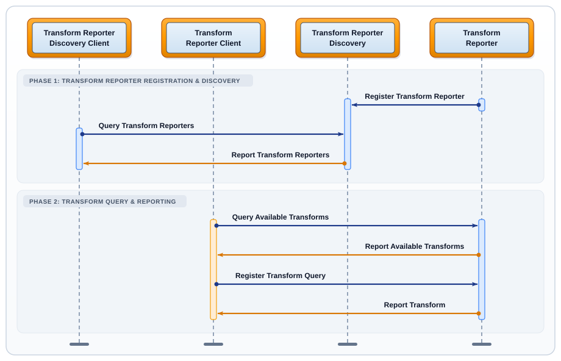
